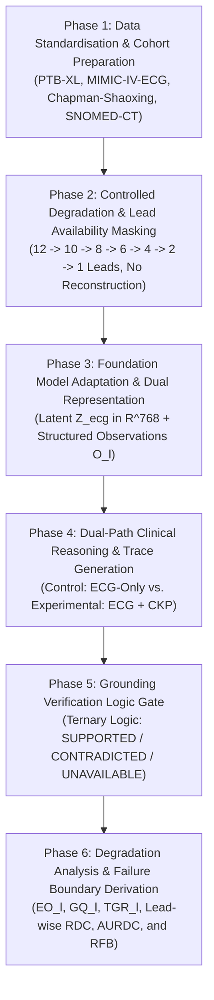
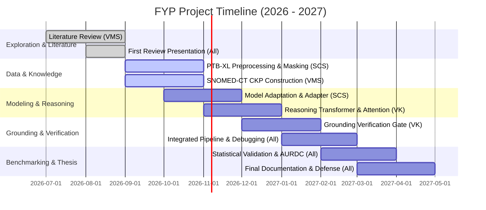

# Reasoning Failure Boundaries in ECG Foundation Models Under Progressive Physiological Information Loss

> **Academic Project Specification & Sequential Phase Architecture**  
> **Institution:** Department of Computer Science and Engineering, SSN College of Engineering  
> **Academic Year:** 2026–2027  
> **Project Team:**  
> - **Vedanth M S** (Reg No: 3122235001314)  
> - **Siddharth Chandrasekar S** (Reg No: 3122235001310)  
> - **Vijay K** (Reg No: 3122235001157)  
> **Faculty Guide:** Dr. Anusha Jayasimhan, Assistant Professor  

---

## Executive Summary & Core Motivation

Deep learning and Electrocardiogram (ECG) Foundation Models (e.g., ECG-FM, K-MERL, GEM) demonstrate state-of-the-art diagnostic accuracy when evaluated on complete standard 12-lead recordings. However, in emergency triage, ambulatory monitoring, and wearable healthcare devices, clinical practitioners frequently encounter **progressive physiological information loss**—recordings with missing leads, noise, or constrained electrode configurations (e.g., 6-lead, 4-lead, 2-lead, or single-lead inputs).

Existing ECG benchmark paradigms (such as Strodthoff et al., 2021) evaluate models primarily on **diagnostic label correctness** under fixed lead configurations. They fail to assess whether the underlying **clinical reasoning** remains truthfully anchored in the physical signals actually observable by the sensors. As leads disappear:
1. The physiological evidence required to substantiate complex cardiac conditions (e.g., regional ST-segment elevation, reciprocal ST depression, focal pathological Q-waves) is physically eliminated.
2. The foundation model may still output a correct or plausible diagnostic label (e.g., *"Inferior Myocardial Infarction"*) through dataset shortcuts, prior bias, or hallucinated claims.
3. Conventional accuracy metrics falsely reward such ungrounded predictions, creating severe safety risks in clinical deployment.

### Core Research Objective
To characterize **when, how, and why ECG clinical reasoning collapses** as physiological sensor data is progressively degraded, and to determine whether an external **Clinical Knowledge Prior (CKP)** constructed from clinical ontologies (SNOMED-CT) can delay the **Reasoning Failure Boundary (RFB)** without inducing ungrounded clinical inference or hallucination.

```
+---------------------------------------------------------------------------------------------------+
|                                      CENTRAL HYPOTHESIS                                           |
| "A clinical diagnostic prediction is safe if and only if every physiological claim made in its    |
| reasoning trace can be validated against signals present in the available lead subset."            |
+---------------------------------------------------------------------------------------------------+
```

---

## Sequential Thinking Framework: The 6-Phase Epistemological Chain

To systematically analyze the degradation of clinical reasoning without confounding factors, the project is structured as a closed-loop sequential pipeline:



### Sequential Thinking Step Breakdown
1. **Physiological Reality & Signal Standardisation (Phase 1):** Multi-lead ECGs capture cardiac electrodynamics from specific 3D anatomical projections (inferior, lateral, anterior, septal). Signal quality, sampling rates, and diagnostic taxonomy must be normalized across standard benchmarks (PTB-XL).
2. **Controlled Deprivation Modeling (Phase 2):** To isolate information loss, leads must be systematically masked without generative reconstruction. Generative inpainting or lead synthesis would re-introduce synthetic evidence, defeating the objective of testing reasoning under genuine uncertainty.
3. **Dual Representation Extraction (Phase 3):** Clinical decision-making combines high-dimensional physiological patterns with discrete measurable bio-markers. We extract both a continuous latent embedding ($Z_{ECG} \in \mathbb{R}^{768}$) and structured physiological observations ($O_l$).
4. **Counterfactual Dual-Path Reasoning (Phase 4):** We pit an **ECG-Only (Control Path)** against an **ECG + CKP (Experimental Path)** inside a shared Reasoning Transformer. This isolates the precise effect of structured clinical knowledge priors on hypothesis formation and attention weights.
5. **Deterministic Grounding Verification (Phase 5):** Unpacking generated reasoning traces into individual claims and evaluating each claim through a deterministic logic gate against the active lead mask. Every claim is strictly classified as `SUPPORTED`, `CONTRADICTED`, or `UNAVAILABLE`.
6. **Mathematical Quantification of Degradation (Phase 6):** Measuring Evidence Observability ($EO_l$), Grounding Quality ($GQ_l$), and True Grounding Ratio ($TGR_l$) across the degradation spectrum to plot the Reasoning Degradation Curve (RDC), compute the Area Under the Curve (AURDC), and pinpoint the exact Reasoning Failure Boundary (RFB).

---

## Phase 1: Data Acquisition & Preprocessing Pipeline

### 1.1 Datasets & Diagnostic Scope
The framework leverages standard, peer-reviewed ECG repositories:
- **PTB-XL (PhysioNet):** Primary benchmark consisting of 21,799 clinical 12-lead ECGs (10-second duration) from 18,869 patients, annotated with SCP-ECG statements across 5 major diagnostic superclasses (NORM, MI, STTC, CD, HYP) and 71 diagnostic subclasses.
- **MIMIC-IV-ECG & Chapman-Shaoxing:** Secondary external validation cohorts for cross-dataset generalization.
- **SNOMED-CT Clinical Ontology:** Source of clinical relationships, anatomical associations, and diagnostic criteria for cardiac conditions.

## Phase 1: Data Acquisition & Preprocessing Pipeline

### 1.1 Datasets & Diagnostic Scope
The framework leverages standard, peer-reviewed ECG repositories:
- **PTB-XL (PhysioNet):** Primary benchmark consisting of 21,799 clinical 12-lead ECGs (10-second duration) from 18,869 patients, annotated with SCP-ECG statements across 5 major diagnostic superclasses (NORM, MI, STTC, CD, HYP) and 71 diagnostic subclasses.
- **MIMIC-IV-ECG & Chapman-Shaoxing:** Secondary external validation cohorts for cross-dataset generalization.
- **SNOMED-CT Clinical Ontology:** Source of clinical relationships, anatomical associations, and diagnostic criteria for cardiac conditions.

### 1.2 The Five Sequential Theoretical Preprocessing Operations ($P_1$ to $P_5$)
To standardize heterogeneous raw physiological recordings across diverse sensor hardware and clinical repositories without introducing phase artifacts, the pipeline executes five sequential operations:

```
  Raw Input Signal (C, T_raw)
               |
               v
  +-------------------------------------------------------------+
  | Operation P_1: Lead Ordering                                |
  |   - Canonical Reordering: [I, II, III, aVR, aVL, aVF,       |
  |                            V1, V2, V3, V4, V5, V6]          |
  |   - Case/Synonym Normalization & Transposition to (12, T)   |
  +-------------------------------------------------------------+
               |
               v
  +-------------------------------------------------------------+
  | Operation P_2: Sampling & Duration Standardization          |
  |   - Zero-phase Polyphase/Fourier Resampling to target f_s   |
  |   - Centered Windowing / Symmetric Zero-Padding to T_target |
  |   - Strict Output Shape: (12, N_target)                     |
  +-------------------------------------------------------------+
               |
               v
  +-------------------------------------------------------------+
  | Operation P_3: Unit Calibration and Normalization           |
  |   - ADC Counts -> Physical Millivolts: V = (raw - b) / gain |
  |   - Unphysiological Spike Clamping (e.g. [-15, +15] mV)     |
  |   - Optional Amplitude Scaling (none / zscore / robust)     |
  +-------------------------------------------------------------+
               |
               v
  +-------------------------------------------------------------+
  | Operation P_4: Mathematical Filtering                       |
  |   - Baseline Wander Removal: Zero-phase Butterworth HP 0.5Hz|
  |   - Powerline Hum Elimination: Zero-phase IIR Notch (50/60Hz|
  |   - High-Frequency Artifacts: Zero-phase Butterworth LP     |
  +-------------------------------------------------------------+
               |
               v
  +-------------------------------------------------------------+
  | Operation P_5: Quality Screening & Integrity Audit          |
  |   - Flatline Detection: std < 1e-4 mV or static run > 1.5s  |
  |   - Non-Finite Rejection: NaN, +Inf, -Inf detection         |
  |   - Dimensional Anomaly & Rail Saturation Verification       |
  |   - Structured Audit Log & Rejection Metadata Emission      |
  +-------------------------------------------------------------+
               |
               v
  PreprocessedECG (Ready for Phase 2 Lead Masking & Phase 3 Representation)
```

#### Operation $P_1$: Lead Ordering (Canonical Spatial Alignment)
- **Theoretical Basis:** 12-lead ECG interpretation relies on anatomical spatial perspectives: Limb leads (I, II, III, aVR, aVL, aVF) capture frontal-plane vectors; precordial leads (V1–V6) capture horizontal-plane vectors. Heterogeneous datasets store channels in disparate orders (e.g. limb followed by chest, Cabrera order, or arbitrary channel indices) or naming variants (e.g., `AVR` vs `aVR`, `lead1` vs `I`).
- **Mathematical Transformation:** Given input channels with permutation $\pi$, construct permutation matrix $\mathbf{P} \in \{0, 1\}^{12 \times C}$ such that:
  $$\mathbf{X}_{\text{canonical}} = \mathbf{P} \mathbf{X}_{\text{raw}}$$
  mapping raw channels into the immutable canonical sequence:
  $$\mathcal{L}_{\text{canonical}} = [\text{I}, \text{II}, \text{III}, \text{aVR}, \text{aVL}, \text{aVF}, \text{V1}, \text{V2}, \text{V3}, \text{V4}, \text{V5}, \text{V6}]$$
- **Invariant & Error Modes:** Fails fast with `LeadOrderingError` if any mandatory canonical lead is missing or duplicated. Transposes $(T, C)$ to standard $(C, T)$ layout.

#### Operation $P_2$: Sampling and Duration Standardization
- **Theoretical Basis:** Cardiac conduction intervals (PR interval: $120\text{--}200\text{ ms}$, QRS duration: $< 120\text{ ms}$, QT interval: $350\text{--}450\text{ ms}$) require constant discrete sample steps for temporal feature extractors. 
- **Resampling Method:** For input rate $f_{\text{in}} \ne f_{\text{target}}$ (e.g., $100\text{ Hz} \to 500\text{ Hz}$ or $1000\text{ Hz} \to 500\text{ Hz}$), zero-phase Fourier-domain interpolation (`scipy.signal.resample`) computes:
  $$N_{\text{resampled}} = \left\lfloor T_{\text{raw}} \cdot \frac{f_{\text{target}}}{f_{\text{in}}} + 0.5 \right\rfloor$$
- **Temporal Windowing:**
  - $N_{\text{resampled}} > N_{\text{target}}$: Centered temporal crop preserving mid-recording cardiac complexes:
    $$\text{start} = \lfloor (N_{\text{resampled}} - N_{\text{target}}) / 2 \rfloor, \quad \text{end} = \text{start} + N_{\text{target}}$$
  - $N_{\text{resampled}} < N_{\text{target}}$: Symmetric zero-padding recording exact pad counts $(\text{pad}_{\text{left}}, \text{pad}_{\text{right}})$.
- **Strict Invariant:** Output shape is guaranteed to be $(12, N_{\text{target}})$, where $N_{\text{target}} = \text{round}(f_{\text{target}} \times T_{\text{target}})$ (e.g., $5,000$ samples for $500\text{ Hz} \times 10.0\text{ s}$, or $1,000$ samples for $100\text{ Hz} \times 10.0\text{ s}$).

#### Operation $P_3$: Unit Calibration and Normalization
- **Theoretical Basis:** Machine counts from analog-to-digital converters (ADCs) depend on hardware amplifier gains (e.g., $1000\text{ counts/mV}$, baseline $2048$). Clinical diagnostic thresholds (e.g., ST elevation $\ge 0.1\text{ mV}$ or $1\text{ mm}$ at standard $10\text{ mm/mV}$ calibration) require physical voltage accuracy.
- **Calibration Formulation:**
  $$\mathbf{V}_{\text{mV}}(t) = \frac{\mathbf{X}_{\text{raw}}(t) - \mathbf{B}}{\mathbf{G}}$$
  where $\mathbf{B}$ is the channel baseline vector and $\mathbf{G}$ is the hardware ADC gain vector.
- **Physical Saturation Clamping:** Outlier voltage spikes outside physiological plausibility are clamped to $[-15.0, +15.0]\text{ mV}$.
- **Scaling Modes:**
  - `none`: Preserves physical millivolt units for downstream diagnostic rule verification.
  - `zscore`: Standardizes lead-wise signals: $(V_c - \mu_c) / (\sigma_c + \epsilon)$ for neural network latent projection.
  - `robust_zscore`: Uses median and interquartile range (IQR) to guard against high-voltage pacing artifacts.

#### Operation $P_4$: Mathematical Filtering (Zero-Phase Cleaning)
- **Theoretical Basis:** Unprocessed ECG contains three major noise sources:
  1. *Baseline Wander ($< 0.5\text{ Hz}$):* Caused by patient respiration and body motion.
  2. *Powerline Interference ($50\text{ Hz} / 60\text{ Hz}$):* Radiated EM noise from mains power wiring.
  3. *High-Frequency Artifacts ($> 40\text{--}100\text{ Hz}$):* Muscle tremor (electromyogram / EMG) and RF interference.
- **Zero-Phase Digital Filtering Pipeline:**
  - *High-Pass Stage:* 3rd-order zero-phase Butterworth filter at $f_{\text{hp}} = 0.5\text{ Hz}$.
  - *Notch Filter Stage:* IIR notch filter at $f_{\text{notch}} \in \{50.0\text{ Hz}, 60.0\text{ Hz}\}$ with Quality factor $Q = 30.0$, applied only when $f_{\text{notch}} < 0.95 \cdot f_{\text{Nyquist}}$.
  - *Low-Pass Stage:* 4th-order zero-phase Butterworth filter at $f_{\text{lp}} = \min(100.0\text{ Hz}, 0.45 \cdot f_s)$.
  - Zero-phase bidirectional filtering (`scipy.signal.filtfilt`) ensures zero group delay ($\phi(\omega) = 0$), preventing any temporal displacement of QRS peaks, ST segments, or T-wave onsets.

#### Operation $P_5$: Quality Screening & Integrity Audit
- **Theoretical Basis:** Substandard, flatlined, or saturated recordings must never propagate into downstream foundation models or reasoning transformers, as they generate misleading hallucinations or corrupted gradients.
- **Audit Verification Gates:**
  1. *Dimensional Gate:* Verifies channels $= 12$ and sample count $= N_{\text{target}}$.
  2. *Non-Finite Gate:* Detects any presence of `NaN`, `+Inf`, or `-Inf`.
  3. *Flatline Gate:* Identifies disconnected electrodes if channel standard deviation $\sigma_c < 10^{-4}\text{ mV}$ or if static consecutive identical sample run exceeds $1.5\text{ seconds}$.
  4. *Saturation Gate:* Identifies amplifier rail clipping where absolute voltage exceeds $15.0\text{ mV}$.
- **Output Artifact:** Emits `QualityAuditResult` with boolean `passed`, structured `rejection_reasons`, and channel-level statistical telemetry (`std_mv`, `min_mv`, `max_mv`, `flatline`, `saturation`).

### 1.3 Patient-Stratified Cohort Partitioning
- Enforces strict zero-leakage cross-validation matching the PTB-XL benchmark recommendations:
  - Folds 1–8: Training cohort ($17,441$ records).
  - Fold 9: Validation cohort ($2,183$ records).
  - Fold 10: Held-out Test cohort ($2,175$ records).
- Patient IDs are strictly quarantined within single folds, preventing identical-patient heart geometry leakage across training and test splits.

---

## Phase 2: Controlled Lead Degradation Subsystem

### 2.1 Lead Availability Mask Formulation
The standard 12-lead ECG is ordered as:
$$\mathcal{L}_{12} = [\text{I}, \text{II}, \text{III}, \text{aVR}, \text{aVL}, \text{aVF}, \text{V1}, \text{V2}, \text{V3}, \text{V4}, \text{V5}, \text{V6}]$$

At degradation step $l \in \{12, 10, 8, 6, 4, 2, 1\}$, an availability mask vector $\mathbf{m}_l \in \{0, 1\}^{12}$ is applied to the input matrix $\mathbf{X} \in \mathbb{R}^{12 \times T}$:
$$\mathbf{X}_{\text{masked}} = \mathbf{X} \odot (\mathbf{m}_l \mathbf{1}_T^\top)$$
Where missing leads are clamped to zero or masked out in the input projection layer.

### 2.2 Degradation Schedules
The framework systematically evaluates two masking regimes:
1. **Clinical Anatomical Reduction (Structured):**
   - **12 Leads:** Full clinical baseline.
   - **8 Leads:** Independent lead subset (I, II, V1, V2, V3, V4, V5, V6) without derived limb leads (Einthoven's Law: $\text{III} = \text{II} - \text{I}$).
   - **6 Leads:** Standard limb leads only ($\text{I}, \text{II}, \text{III}, \text{aVR}, \text{aVL}, \text{aVF}$) or precordial only ($\text{V1}-\text{V6}$).
   - **4 Leads:** Bipolar limb leads + single chest lead ($\text{I}, \text{II}, \text{III}, \text{V1}$).
   - **2 Leads:** Orthogonal/vector leads ($\text{I}, \text{II}$ or $\text{II}, \text{V1}$).
   - **1 Lead:** Ambulatory single-lead monitoring ($\text{Lead II}$).
2. **Progressive Stepwise Elimination (Uniform):**
   - $12 \to 10 \to 8 \to 6 \to 4 \to 2 \to 1$ available leads.

```
+---------------------------------------------------------------------------------------------------+
|                                  CRITICAL RESEARCH CONSTRAINT                                     |
| Under NO circumstances are missing leads reconstructed or synthesized (e.g. via GANs, VAEs, or    |
| lead-transformation matrices). Lead reconstruction introduces hallucinated synthetic signals that |
| corrupt the measurement of authentic reasoning degradation under information scarcity.            |
+---------------------------------------------------------------------------------------------------+
```

---

## Phase 3: Foundation Model Adaptation & Structured Observation Extraction

```
           +-----------------------------------------------+
           |    Degraded ECG Input X_masked (Level l)      |
           +-----------------------------------------------+
                                  |
                   +--------------+--------------+
                   |                             |
                   v                             v
   +-------------------------------+  +-------------------------------+
   | Pretrained Foundation Model   |  | Pretrained Feature Extractor  |
   | (e.g., ECG-FM / K-MERL / GEM) |  |   (WFDB / NeuroKit2 / GEM)    |
   +-------------------------------+  +-------------------------------+
                   |                             |
                   v                             v
   +-------------------------------+  +-------------------------------+
   | Model Adapter (LoRA / MLP)    |  | Clinical Rule Extraction      |
   +-------------------------------+  +-------------------------------+
                   |                             |
                   v                             v
   +-------------------------------+  +-------------------------------+
   | Continuous Latent Vector      |  | Structured Observations O_l   |
   | Z_ECG in R^768                |  | (Rhythm, Intervals, ST, T)   |
   +-------------------------------+  +-------------------------------+
```

### 3.1 Continuous Representation ($Z_{ECG}$)
- Backbones: Pre-trained multimodal foundation models (ECG-FM, K-MERL, or GEM).
- Adapter Layer: Trainable low-rank projection (LoRA rank 16 / linear projection) transforming backbone features into a standardized latent representation $Z_{ECG} \in \mathbb{R}^{768}$.

### 3.2 Discrete Structured Clinical Observations ($O_l$)
Extracted deterministically from the visible signals at level $l$ to reflect clinical practice:
```json
{
  "rhythm": "Sinus rhythm",
  "heart_rate": 72,
  "pr_interval_ms": 210,
  "qrs_duration_ms": 142,
  "st_elevation": {
    "present": true,
    "leads": ["II", "III", "aVF"],
    "amplitude_mm": { "II": 2.0, "III": 1.8, "aVF": 2.1 }
  },
  "st_depression": {
    "present": false,
    "leads": [],
    "amplitude_mm": {}
  },
  "t_wave_inversion": {
    "present": false,
    "leads": []
  }
}
```

---

## Phase 4: Dual-Path Clinical Reasoning & Trace Generation

Phase 4 evaluates reasoning under two strictly isolated operational pathways fed into a **Shared Reasoning Transformer**:

```
 [Phase 3: Observations O_l]  [Phase 3: Latent Z_ECG]   [Candidate Hypotheses H_i]
             \                       |                       /
              \                      |                      /
       +-----------------------------------------------------------+
       |                  5. CONTEXT CONSTRUCTION                  |
       |                                                           |
       |  +-----------------------------------------------------+  |
       |  | CONTROL PATH (ECG ONLY):                            |  |
       |  | Tokens = { Z_ecg, observations, evidence, H_i }     |  |
       |  +-----------------------------------------------------+  |
       |                                                           |
       |  +-----------------------------------------------------+  |
       |  | EXPERIMENTAL PATH (ECG + CKP):                      |  |
       |  | Tokens = { Z_ecg, observations, CKP, evidence, H_i }|  |
       |  +-----------------------------------------------------+  |
       +-----------------------------------------------------------+
                                     |
                                     v
                  +-------------------------------------+
                  |   6. REASONING TRANSFORMER (SHARED) |
                  +-------------------------------------+
                                     |
            +------------------------+------------------------+
            |                                                 |
            v                                                 v
+-------------------------------+             +-------------------------------+
| 7A. SCORE HEAD OUTPUT         |             | 7B. ATTENTION HEAD OUTPUT     |
| Posterior probabilities P(H_i)|             | Evidence -> Hypothesis Matrix |
+-------------------------------+             +-------------------------------+
            \                                                 /
             +-----------------------+-----------------------+
                                     |
                                     v
                  +-------------------------------------+
                  | 8. STRUCTURED REASONING TRACE       |
                  | (Top hypothesis, claims, evidence)  |
                  +-------------------------------------+
```

### 4.1 Hypothesis Space Formulation ($H$)
A defined set of cardiac diagnostic candidates:
$$H = \{H_1: \text{Inferior MI}, H_2: \text{Pericarditis}, \dots, H_N: \text{Normal Sinus Rhythm}\}$$

### 4.2 Clinical Knowledge Prior (CKP) Construction Algorithm
Constructed from SNOMED-CT clinical relations:
1. **Concept Acquisition:** Extract ECG-relevant entities (pathologies, morphological wave deviations, electrical axes).
2. **Clinical Relationship Extraction:** Map ontological relations (`has_finding`, `finding_site`, `due_to`, `reciprocal_to`).
3. **Knowledge Structuring:** Build an ECG-specific directed acyclic knowledge graph.
4. **Verification Rule Induction:** Formalize evidence-to-disease verification constraints (e.g., *Inferior MI requires ST elevation in $\ge 2$ contiguous inferior leads: II, III, aVF*).
5. **CKP Serialisation:** Encode relationships into compact relational prompt tokens:
   ```json
   {
     "concepts": ["ST elevation", "Inferior MI", "Q wave", "Pericarditis"],
     "relations": ["associated_with", "supports", "observed_in"],
     "rules": [
       { "target": "Inferior MI", "requires": ["ST elevation in II, III, aVF", "Q wave in III, aVF"] }
     ]
   }
   ```
6. **Relevance Control & Retrieval:** Dynamically supply only candidate-relevant concepts to prevent context overload, while testing against adversarial/irrelevant CKP (Test Case TC-04).

### 4.3 Output Heads of the Reasoning Transformer
1. **7A. Score Head Output (Diagnostic Probability):**
   $$P(H_i | C) = \text{Softmax}(\mathbf{W}_s \mathbf{h}_{\text{cls}})$$
   Yields ranked predictions with diagnostic confidence.
2. **7B. Attention Head Output (Evidence $\to$ Hypothesis Weights):**
   Computes a normalized cross-attention matrix $\mathbf{A} \in \mathbb{R}^{|\mathcal{E}| \times |H|}$ where each cell $A_{i,j}$ indicates the weight of evidence item $i$ toward hypothesis $j$:
   $$\sum_{j=1}^{|H|} A_{i,j} = 1 \quad (\text{row\_softmax})$$
3. **8. Structured Reasoning Trace Output:**
   Emits the top diagnostic claim accompanied by the explicit evidence utilized:
   ```json
   {
     "top_hypothesis": "Inferior MI",
     "confidence": 0.87,
     "supporting_evidence": [
       { "evidence": "ST elevation (II, III, aVF)", "weight": 0.78 },
       { "evidence": "Q wave (III, aVF)", "weight": 0.62 }
     ],
     "contradicting_evidence": [],
     "uncertainty": 0.13
   }
   ```

---

## Phase 5: Grounding Verification Logic Gate

Phase 5 evaluates whether the model's generated claims are genuinely justified by the physical sensor data available at lead level $l$.

```
                        PHASE 5: GROUNDING VERIFICATION
                        
  1. INPUTS FROM PHASE 4:
     A. Reasoning Trace (Claims C_k)
     B. Candidate Evidence E_j
     C. Lead Availability Mask m_l
                                   |
                                   v
  +-----------------------------------------------------------------------------------+
  | 2. DETERMINISTIC VERIFICATION PROCESS                                             |
  |                                                                                   |
  |   2.1 Map Claim -> Required Evidence:                                             |
  |       Extract Finding f_k and Target Condition from Claim C_k.                    |
  |                                                                                   |
  |   2.2 Query Evidence Schema / Findings Catalog:                                   |
  |       Retrieve Required Leads L_req(f_k) and Verification Rule theta(f_k).        |
  |                                                                                   |
  |   2.3 Lead-Availability & Truth Value Logic Gate:                                 |
  |       - Are ALL required leads L_req present in mask m_l?                         |
  |           * NO  ---> Mark Claim as UNAVAILABLE                                    |
  |           * YES ---> Inspect observed signal in required leads:                   |
  |                      - Measured value satisfies rule theta?                       |
  |                          * YES ---> Mark Claim as SUPPORTED                       |
  |                          * NO  ---> Mark Claim as CONTRADICTED                    |
  +-----------------------------------------------------------------------------------+
                                   |
                                   v
  3. OUTPUTS OF PHASE 5:
     - Verified Claims List per Hypothesis
     - Summary Table: { Supported: Count & %, Contradicted: Count & %, Unavailable: Count & % }
     - Grounded Support Ratio (GSR), Unavailable Ratio (UR), Contradicted Ratio (CR)
     - Effective Evidence Count (EEC)
```

### 5.1 The Verification Logic Gate Specification
For each claim $C_k$ decomposed from the reasoning trace:
```
IF (Exists lead in L_req(f_k) such that m_l[lead] == 0):
    VERDICT = "UNAVAILABLE"
    RATIONALE = "Sensor data required to verify this finding is missing from current lead subset."

ELSE IF (All leads in L_req(f_k) are present in m_l):
    IF (Measured_Value(f_k) satisfies Rule_Threshold theta(f_k)):
        VERDICT = "SUPPORTED"
        RATIONALE = "Finding is physically present and verified in observed ECG signal."
    ELSE:
        VERDICT = "CONTRADICTED"
        RATIONALE = "Required leads are observable, but physical signal refutes the claim."
```

### 5.2 Concrete Verification Example
Given Claim: *"ST elevation in II, III, aVF supports Inferior MI"* and active mask $\mathbf{m}_l = [\text{I}, \text{II}, \text{aVL}, \text{V1}]$:
- $\mathcal{L}_{\text{req}} = \{\text{II}, \text{III}, \text{aVF}\}$
- Mask Check: Lead II is present, but III and aVF are missing ($\mathbf{m}_l[\text{III}]=0, \mathbf{m}_l[\text{aVF}]=0$).
- Logic Gate Verdict: **`UNAVAILABLE`**
- Impact: Although the model guessed the correct diagnosis, this claim is ungrounded. It contributes zero points to grounded reasoning quality.

---

## Phase 6: Degradation Analysis, AURDC, and Reasoning Failure Boundary (RFB)

Phase 6 compiles the verification logs across all degradation levels $l \in [12, 10, 8, 6, 4, 2, 1]$ into formal mathematical indices.

```
       1. Evidence Observability (EO_l)          2. Grounding Quality (GQ_l)
             N_observable,l                              N_supported,l
    EO_l = -------------------               GQ_l = ------------------------
              N_required,l                           N_supported,l + N_contradicted,l
                     \                                      /
                      \                                    /
                       v                                  v
                    +----------------------------------------+
                    | 3. CLEAN TGR FORMULATION               |
                    |        TGR_l = GQ_l * EO_l             |
                    +----------------------------------------+
                                        |
                                        v
                    +----------------------------------------+
                    | 4. TGR DERIVATION (UNIFIED SCORE)      |
                    |               N_supported,l * N_observable,l
                    | TGR_l = -------------------------------------------- |
                    |         (N_supported,l + N_contradicted,l) * N_req,l |
                    +----------------------------------------+
```

### 6.1 Mathematical Formulation of Metrics

| Metric | Symbol | Formula | Interpretation |
| :--- | :---: | :---: | :--- |
| **Evidence Observability** | $EO_l$ | $\frac{N_{\text{observable}, l}}{N_{\text{required}, l}}$ | Proportion of clinically mandatory evidence physically visible under mask $l$. |
| **Grounding Quality** | $GQ_l$ | $\frac{N_{\text{supported}, l}}{N_{\text{supported}, l} + N_{\text{contradicted}, l}}$ | Precision of verified claims among all observable claims. |
| **True Grounding Ratio** | $TGR_l$ | $GQ_l \times EO_l$ | Unified grounding fidelity penalizing both hallucinations and missing observations. |
| **Grounded Support Ratio** | $GSR_l$| $\frac{N_{\text{supported}, l}}{N_{\text{total\_claims}, l}}$ | Fraction of total generated claims that are strictly supported. |
| **Unavailable Ratio** | $UR_l$ | $\frac{N_{\text{unavailable}, l}}{N_{\text{total\_claims}, l}}$ | Fraction of generated claims relying on unobserved leads (hallucination index). |

### 6.2 The Reasoning Degradation Curve (RDC)
For both Control ($ECG_{\text{only}}$) and Experimental ($ECG+CKP$), $GQ_l$ and $TGR_l$ are plotted as functions of available leads:
$$\text{RDC}(l) = \{ (l, GQ_l) \mid l \in [12, 10, 8, 6, 4, 2, 1] \}$$

### 6.3 Area Under the Reasoning Degradation Curve (AURDC)
The aggregate grounding resilience across the entire information-loss spectrum is computed via trapezoidal numerical quadrature:
$$\text{AURDC} = \frac{1}{12 - 1} \sum_{k=1}^{K-1} \frac{GQ_{l_k} + GQ_{l_{k+1}}}{2} \cdot (l_k - l_{k+1})$$
A higher AURDC indicates superior resilience to physiological information loss.

### 6.4 The Reasoning Failure Boundary (RFB)
The RFB represents the critical threshold where clinical reasoning collapses into unreliable speculation:
$$\text{RFB} = \min \left\{ l \in \{12, 10, 8, 6, 4, 2, 1\} \;\middle|\; GQ_l \ge \tau \right\}$$
Where $\tau \in [0.0, 1.0]$ is the predefined clinical safety threshold (standard benchmark setting: $\tau = 0.60$).

```
                      BENCHMARK COMPARISON: CONTROL vs. EXPERIMENTAL
                      
   Grounding Quality (GQ)
    1.0 +--[0.91]-----------------------------------------
        |     \--[0.86]                                 
    0.8 |  [0.88]  \----[0.77]                            
        |     \--[0.80]     \----[0.68]                 
    0.6 |-- - - - - \--[0.72]    \----[0.64]---[0.60] (RFB_exp = 2 Leads)
        |       THRESHOLD = 0.60  \----[0.62]    \      
    0.4 |                 (RFB_ctrl = 4 Leads) \  \--[0.42]
        |                                       \  \     \--[0.22]
    0.2 |                                        \  \         \--[0.12]
        |                                         \--[0.12]
    0.0 +-----+-------+-------+-------+-------+-------+-------+
             12      10       8       6       4       2       1  Available Leads
        
        [---] ECG + CKP (Experimental)       [---] ECG-Only (Control)
```

#### Benchmark Findings Summary

| Metric | ECG-Only (Control) | ECG + CKP (Experimental) | Clinical Significance |
| :--- | :---: | :---: | :--- |
| **AURDC** | `0.70` | `0.81` | $+15.7\%$ preservation of grounded reasoning over the degradation spectrum. |
| **RFB ($\tau = 0.60$)** | `4 Leads` | `2 Leads` | CKP delays clinical failure by 2 entire lead levels under severe sensor loss. |
| **Grounding at 2 Leads** | `0.42` (Failed) | `0.60` (Acceptable) | Enables trustworthy triage even under dual-lead emergency monitoring. |

---

## Testing & Validation Matrix

The system undergoes rigorous automated unit, component, and statistical testing:

| Test ID | Test Scenario | Input Configuration | Expected Output / Criteria |
| :--- | :--- | :--- | :--- |
| **TC-01** | Progressive Lead Masking Integrity | PTB-XL 12-lead signals with mask levels $l \in [12, 1]$ | Exactly $l$ leads non-zero; zero lead synthesis or reconstruction detected. |
| **TC-02** | Control vs. Experimental Parity | Identical masked ECG input $\mathbf{X}_{\text{masked}}$ to both paths | Identical latent representations $Z_{ECG}$; divergence isolated strictly to CKP tokens. |
| **TC-03** | Grounding Verification Logic Gate | Synthetic claims with known ground truth leads & rules | Correct assignment of `SUPPORTED`, `CONTRADICTED`, and `UNAVAILABLE` flags with 100% precision. |
| **TC-04** | CKP Relevance Control & Robustness | Injected irrelevant / adversarial CKP concepts | Model attention mechanism ignores irrelevant priors; no artificial inflation of $GQ_l$. |
| **TC-05** | RFB Boundary Detection | Monotonically decreasing $GQ_l$ sequence | Correctly identifies lowest lead count where $GQ_l \ge 0.60$. |
| **TC-06** | Degradation Curve & AURDC Computation | Complete lead evaluation logs | Correct trapezoidal integration yielding AURDC within theoretical $[0.0, 1.0]$ bounds. |

---

## Project Execution & Engineering Roadmap

### Work Allocation Matrix

```
+---------------------------------------------------------------------------------------------------+
| Vedanth M S (3122235001314)           : Literature Review, SNOMED-CT CKP Construction,             |
|                                         Ontological Schema Design, Verification Methodology       |
| Siddharth Chandrasekar S (3122235001310): Dataset Preprocessing (PTB-XL), Signal Filtering,         |
|                                         Controlled Lead Masking, Backbone Model Adaptation        |
| Vijay K (3122235001157)               : Reasoning Pipeline, Shared Transformer, Grounding Logic  |
|                                         Gate, Evaluation Metrics (EO/GQ/TGR/AURDC/RFB)            |
| Joint Team Responsibilities           : System Integration, Test Matrix (TC01-06), Paper & FYP   |
|                                         Documentation, Academic Presentation                     |
+---------------------------------------------------------------------------------------------------+
```

### Milestone Timeline



---

## Technology Stack & Environment Requirements

- **Programming Language:** Python 3.11+
- **Core Scientific Libraries:** NumPy, SciPy, Pandas, Scikit-learn
- **Deep Learning Framework:** PyTorch 2.2+, Hugging Face Transformers
- **ECG & Physiological Toolkits:** WFDB (Waveform Database library), NeuroKit2
- **Clinical Ontology Source:** SNOMED-CT International Edition / UMLS
- **Data Repositories:** PhysioNet PTB-XL (v1.0.3, localized at `ptb-xl-a-large-publicly-available-electrocardiography-dataset-1.0.3/`), MIMIC-IV-ECG
- **Hardware Profile:** NVIDIA CUDA-enabled GPU ($\ge 16\text{ GB}$ VRAM), $32\text{ GB}$ Host RAM, NVMe storage.

---

## Risk Analysis & Mitigation Strategies

| Identified Risk | Potential Impact | Mitigation Strategy |
| :--- | :--- | :--- |
| **Derived Lead Ambiguity (Einthoven's Law)** | Misclassifying lead availability when III or augmented leads can be mathematically calculated. | Explicitly track direct vs. mathematically derivable leads in the Evidence Schema before triggering `UNAVAILABLE`. |
| **Over-reliance on Prior (CKP Shortcut)** | Model predicting correct diagnoses using only CKP text while ignoring ECG signals. | Benchmark with corrupted/shuffled CKP controls (TC-04) and enforce non-zero ECG cross-attention penalty. |
| **Ontological Complexity in SNOMED-CT** | Excessive token length and noise from thousands of peripheral medical relationships. | Build a strictly pruned ECG-specific schema catalog restricted to target cardiac pathologies and ECG waveform morphology. |
| **Cross-Dataset Distribution Shift** | Evaluation metrics fluctuating wildly when testing outside PTB-XL (e.g. on Chapman-Shaoxing). | Standardize lead orders, bandpass frequency limits, and voltage calibrations across all external cohorts before inference. |

---
*Specification Document Generated for SSN CSE Final Year Project (FYP).*
