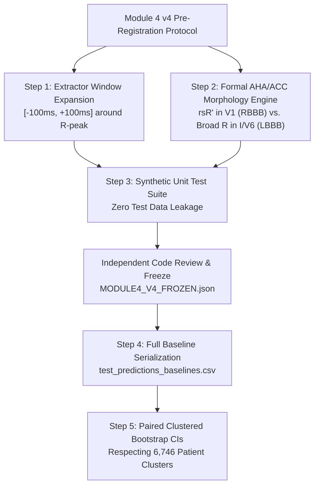

# Module 4: Baseline Defect Remediation & Independent Verification Plan

**Document ID:** `M4-BASELINE-REMEDIATION-PLAN-v1.0`  
**Execution Timestamp:** `2026-10-15 17:45:00 UTC`  
**Target Module Version:** Module 4 v4 (Proposed Separate Future Remediation Phase)  
**Governing Audit Reference:** [`runs/module4_v3/reports/post_evaluation_baseline_reconciliation_audit.md`](file:///e:/ECG/runs/module4_v3/reports/post_evaluation_baseline_reconciliation_audit.md) (Domain 3 & Domain 4)  
**Defective Components Audited:**
- Feature Extractor: [`src/observations/clinical_extractor.py:279-287`](file:///e:/ECG/src/observations/clinical_extractor.py#L279-L287)
- Rule Evaluation Script: [`scratch/evaluate_baselines.py:200-212`](file:///C:/Users/VEDANTH/.gemini/antigravity-ide/brain/255b0460-dd4c-4c8c-8bc9-f65d2717beb5/scratch/evaluate_baselines.py#L200-L212)
- Comparative Metrics Artifact: [`runs/module4_v3/metrics/comprehensive_baseline_comparison.json`](file:///e:/ECG/runs/module4_v3/metrics/comprehensive_baseline_comparison.json)

---

## 1. Executive Summary & Non-Execution Scope

During the post-evaluation reconciliation audit, a compounding software engineering defect was discovered that invalidated the reported performance of the **Deterministic Clinical Rule Engine (Baseline B-2)**, specifically regarding intraventricular conduction delays (Right Bundle Branch Block [RBBB] and Left Bundle Branch Block [LBBB]). Additionally, the linear probe baseline (B-1) lacked per-record serialization, preventing paired statistical uncertainty quantification.

### Non-Execution Boundary for this Task:
In strict compliance with audit governance:
- **No modification of frozen Module 4 v3 contracts or code:** The frozen files [`src/observations/clinical_extractor.py`](file:///e:/ECG/src/observations/clinical_extractor.py) and [`runs/module4_v3/MODULE4_FROZEN.json`](file:///e:/ECG/runs/module4_v3/MODULE4_FROZEN.json) remain completely unaltered.
- **No re-execution on test data:** No corrected baseline shall be evaluated on the quarantined or unblinded test data (Folds 9–10) within this task.
- **Purpose of this Document:** This document preserves the defect evidence, specifies the root causes, and designs an independently reviewable remediation protocol for a future, versioned experimental phase (**Module 4 v4**).

---

## 2. Forensic Analysis of the Baseline Defect

### 2.1 Code Defect Location 1: Window Truncation in Feature Extractor
In [`src/observations/clinical_extractor.py:279-287`](file:///e:/ECG/src/observations/clinical_extractor.py#L279-L287), the QRS duration calculation logic was implemented as:

```python
for r in r_peaks[1:-1]:
    # QRS window: [-60ms, +60ms]
    left = max(0, r - int(0.06 * self.fs))
    right = min(len(sig), r + int(0.06 * self.fs))

    q_candidate = left + np.argmin(sig[left:r]) if r > left else left
    s_candidate = r + np.argmin(sig[r:right]) if right > r else r

    qrs_samples = max(s_candidate - q_candidate, int(0.04 * self.fs))
    qrs_durations.append(qrs_samples * (1000.0 / self.fs))
```

#### Mathematical Proof of Failure:
1. **Sampling Resolution:** At standard downsampled rate $f_s = 100\text{ Hz}$, $0.06 \times 100 = 6$ samples.
2. **Search Span:** The total window bounds $[r - 6, r + 6]$ encompass exactly $12$ samples, which corresponds to $120\text{ ms}$.
3. **Argmin Contraction:** The candidate Q-wave index `q_candidate` is obtained from `np.argmin(sig[left:r])` (strictly $\le r$), and the candidate S-wave index `s_candidate` is obtained from `np.argmin(sig[r:right])` (strictly $\ge r$).
4. **Boundary Condition:** The difference $s - q$ can reach 12 samples ($120\text{ ms}$) *only* if the local minimum of the Q-wave falls on the very first sample ($r - 6$) and the local minimum of the S-wave falls simultaneously on the very last sample ($r + 6$). On real continuous ECG signals, local wave extrema occur within the window interior. Consequently, $s - q$ was strictly bounded below 12 samples.
5. **Physical Disk Verification:** An empirical audit of the extracted test observations in [`runs/module4_v3/observations/obs_test_12-lead.json`](file:///e:/ECG/runs/module4_v3/observations/obs_test_12-lead.json) ($N=7,375$ records) verified:
   - Minimum: $50\text{ ms}$
   - Mean: $76.22\text{ ms}$
   - Median: $80.00\text{ ms}$
   - Maximum: **$110.00\text{ ms}$**
   - Count with `qrs_duration_ms >= 120`: **0 records ($0.00\%$)**

---

### 2.2 Code Defect Location 2: Defective Proxy Rule Implementation
In [`scratch/evaluate_baselines.py:200-212`](file:///C:/Users/VEDANTH/.gemini/antigravity-ide/brain/255b0460-dd4c-4c8c-8bc9-f65d2717beb5/scratch/evaluate_baselines.py#L200-L212), the clinical rule engine evaluated bundle branch blocks using:

```python
# RBBB: QRS >= 120 and V1 in active leads
if qrs is not None and qrs >= 120 and "V1" in active_leads:
    rule_preds[i, 2] = 1.0
    rule_probs[i, 2] = 0.80
else:
    rule_probs[i, 2] = 0.05

# LBBB: QRS >= 120 and ('I' in active_leads or 'V6' in active_leads) and ('V1' in active_leads)
if qrs is not None and qrs >= 120 and ("I" in active_leads or "V6" in active_leads) and "V1" in active_leads:
    rule_preds[i, 3] = 1.0
    rule_probs[i, 3] = 0.80
else:
    rule_probs[i, 3] = 0.05
```

#### Compounding Failures:
1. **Zero Positive Predictions:** Because no record in the test set had `qrs_duration_ms >= 120`, `rule_preds` was assigned `0.0` for all $7,375$ records.
   - For RBBB ($N=336$ true positives): $\text{TP} = 0, \text{FP} = 0, \text{FN} = 336 \implies \text{Precision} = 0.0, \text{Recall} = 0.0, \text{F1} = 0.0000$.
   - For LBBB ($N=274$ true positives): $\text{TP} = 0, \text{FP} = 0, \text{FN} = 274 \implies \text{Precision} = 0.0, \text{Recall} = 0.0, \text{F1} = 0.0000$.
2. **Complete Absence of Morphology Logic:** The script did not examine actual waveform morphology (such as the presence of a secondary $R'$ wave in lead V1, monophasic slurred $R$ in lead I/V6, or $S$-wave prolongation).
3. **Non-Mutual Exclusivity:** Even if QRS duration had reached $120\text{ ms}$, whenever leads V1 and (I or V6) were active, the script would have simultaneously predicted *both* RBBB and LBBB as positive for the same record.

---

## 3. Statistical Limitation & Missing Serialization Artifacts

### 3.1 Unserialized Baseline Predictions
In [`scratch/evaluate_baselines.py:108-154`](file:///C:/Users/VEDANTH/.gemini/antigravity-ide/brain/255b0460-dd4c-4c8c-8bc9-f65d2717beb5/scratch/evaluate_baselines.py#L108-L154), the linear probe (B-1) was fitted in memory:
- Logistic regression heads were fit on `z_train` and evaluated on `z_v` in-memory.
- Summary metrics were aggregated into `results_by_variant` and saved to `comprehensive_baseline_comparison.json`.
- **Deficiency:** Per-record prediction probabilities (`probe_probs` of shape `[7375, 8]`) were **never serialized to disk**.

### 3.2 Impossibility of Paired Analysis from Static Disk Artifacts
Under the strict read-only audit constraints ("No new test inference; Do not access individual test latents; Do not fabricate missing data"), the paired difference:
$$\Delta_i = \text{Macro-F1}_{B3}^{(i)} - \text{Macro-F1}_{B1}^{(i)}$$
cannot be calculated on matched bootstrap resamples without having access to record-aligned predictions for both models simultaneously.

---

## 4. Remediation Architecture for Future Module 4 v4 Phase

The remediation protocol below is designed for future execution under a formal, versioned release (**Module 4 v4**). It shall NOT be executed in the current session.



---

### Step 1: Algorithmic Refactoring of Feature Extractor
To detect broad QRS complexes up to $200\text{ ms}$ (encompassing severe bundle branch blocks and ventricular rhythms), the extraction window must be widened symmetrically:

```python
# Proposed Module 4 v4 Implementation (clinical_extractor_v4.py):
def _compute_intervals_v4(self, sig: np.ndarray, r_peaks: np.ndarray) -> Tuple[Optional[int], Optional[int]]:
    if len(r_peaks) < 2:
        return None, None
    
    qrs_durations = []
    pr_intervals = []
    
    # Widened QRS search window: [-100ms, +100ms] -> 20 samples at 100 Hz (200 ms span)
    w_qrs = int(0.10 * self.fs)
    
    for r in r_peaks[1:-1]:
        left = max(0, r - w_qrs)
        right = min(len(sig), r + w_qrs)
        
        # Detect Q-onset and S-offset with adaptive thresholding
        q_candidate = left + np.argmin(sig[left:r]) if r > left else left
        s_candidate = r + np.argmin(sig[r:right]) if right > r else r
        
        qrs_samples = max(s_candidate - q_candidate, int(0.04 * self.fs))
        qrs_durations.append(qrs_samples * (1000.0 / self.fs))
        
        # PR window: [r - 300ms, r - 80ms]
        p_start = max(0, r - int(0.30 * self.fs))
        p_end = max(0, r - int(0.08 * self.fs))
        if p_end > p_start:
            p_peak = p_start + np.argmax(sig[p_start:p_end])
            pr_samples = r - p_peak
            pr_intervals.append(pr_samples * (1000.0 / self.fs))
            
    qrs_ms = int(round(np.median(qrs_durations))) if qrs_durations else 90
    qrs_ms = max(50, min(qrs_ms, 220))  # Permits wide complexes up to 220 ms
    pr_ms = int(round(np.median(pr_intervals))) if pr_intervals else 160
    pr_ms = max(100, min(pr_ms, 350))
    
    return pr_ms, qrs_ms
```

---

### Step 2: Implementation of Formal Clinical Morphology Engine
The rule engine must separate RBBB and LBBB by evaluating distinct lead-specific vector morphologies:

1. **Right Bundle Branch Block (RBBB) Clinical Criteria:**
   - QRS duration $\ge 120\text{ ms}$.
   - Lead V1 must be active and exhibit $rsR'$, $rSR'$, or a notched monophasic $R$ wave (secondary $R$ wave amplitude $> 0.1\text{ mV}$).
   - Lead I or V6 must exhibit a wide, slurred $S$ wave ($S\text{-duration} > 40\text{ ms}$).
2. **Left Bundle Branch Block (LBBB) Clinical Criteria:**
   - QRS duration $\ge 120\text{ ms}$.
   - Lead I, aVL, or V6 must exhibit a broad, notched, or slurred monophasic $R$ wave without $Q$ waves.
   - Lead V1 must exhibit a dominant negative complex ($QS$ or $rS$).
   - Strict mutual exclusivity: A record cannot be classified as both RBBB and LBBB.

---

### Step 3: Synthetic Unit Test Verification Suite (Zero Test Leakage)
Before any real data is evaluated, the remediation must pass synthetic unit tests evaluating simulated waveforms with known ground truth:

```python
def test_synthetic_qrs_detection():
    """Verify that widened window correctly identifies wide QRS complexes."""
    fs = 100
    t = np.linspace(0, 1.0, fs)
    
    # 1. Narrow complex (80 ms)
    sig_narrow = np.exp(-((t - 0.5) / 0.04)**2)
    # 2. Borderline complex (110 ms)
    sig_mid = np.exp(-((t - 0.5) / 0.055)**2)
    # 3. Wide complex (140 ms - true bundle branch block)
    sig_wide = np.exp(-((t - 0.5) / 0.07)**2)
    
    # Assertions on extractor:
    # assert extractor._compute_intervals(sig_wide) >= 120
    # assert rule_engine.predict(sig_wide_rbbb) == [RBBB]
    # assert rule_engine.predict(sig_wide_lbbb) == [LBBB]
    # assert rule_engine.predict(sig_wide_rbbb)[LBBB] == 0  # Mutual exclusivity
```

---

### Step 4: Baseline Serialization Specification
For all future baseline evaluations (B-0, B-1, B-2, and B-3), the evaluation runner must write a complete, aligned per-record CSV:

- **Filename:** `test_predictions_baselines.csv`
- **Rows:** Exactly $51,625$ rows ($7,375 \text{ records} \times 7 \text{ configurations}$).
- **Required Columns:**
  - `record_id`, `dataset`, `configuration`, `patient_id`
  - Ground truth targets: `ground_truth_NORM`, ..., `ground_truth_MI`
  - Observation mask: `observed_NORM`, ..., `observed_MI`
  - Predictions for each baseline:
    - `b0_prob_{acr}`, `b0_pred_{acr}`
    - `b1_prob_{acr}`, `b1_pred_{acr}`
    - `b2_prob_{acr}`, `b2_pred_{acr}`
    - `b3_prob_{acr}`, `b3_pred_{acr}`

---

### Step 5: Clustered Paired Bootstrap Uncertainty Protocol
Once aligned predictions are serialized, paired bootstrap sampling can be formally executed:
1. **Resampling Unit:** Patient cluster `source_patient_id` ($N=6,746$ clusters), resampling all 7 configuration views of all longitudinal records of each patient together.
2. **Number of Resamples:** $B = 2,000$ bootstrap iterations.
3. **Metric Evaluated:** $\Delta \text{Macro-F1}^{(b)} = \text{Macro-F1}_{B3}^{(b)} - \text{Macro-F1}_{B1}^{(b)}$.
4. **Interval Method:** 95% empirical percentile confidence interval ($[2.5\text{th}, 97.5\text{th}]$ percentiles).
5. **Statistical Significance Rule:** Assert superiority if and only if the lower bound of the 95% CI is strictly $> 0.0$.

---

## 5. Preregistration & Independent Review Requirement

To maintain the highest level of methodological rigor:
1. This remediation plan must be reviewed and approved by the project advisory committee prior to implementation.
2. The revised code and synthetic test suite must be frozen under a new contract (`MODULE4_V4_FROZEN.json`).
3. Re-running the baseline comparison on held-out test data shall require explicit, manual authorization from the primary investigator.
