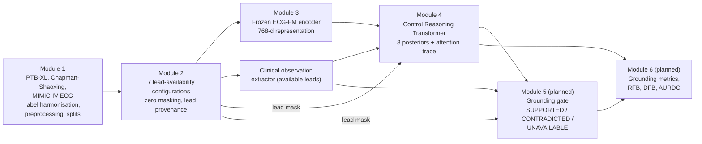

# CHAPTER 3

# PROPOSED METHODOLOGY

## 3.1 ARCHITECTURE DESIGN

The proposed system is organised as a pipeline of six modules, arranged so that physiological information is removed in a controlled way before any model sees the signal, and so that every later stage can tell which leads were actually recorded. Module 1 acquires ECG recordings from three public cohorts, harmonises their diagnostic labels to eight benchmark conditions, standardises every recording to a common signal format, and assigns records to patient-disjoint data partitions. Module 2 applies seven fixed lead-availability configurations to each standardised recording, setting removed leads to zero without reconstructing them and recording which of the remaining leads are measured and which are mathematically derived. Module 3 passes each degraded recording through a frozen ECG foundation model to obtain a single 768-dimensional representation.

Module 4 is the reasoning stage. It combines the foundation-model representation, rule-based physiological observations measured only on the available leads, and the lead-availability mask, and produces a probability for each of the eight conditions together with an attention-based reasoning trace. In the first half of the project this module is implemented as a Control Reasoning Transformer that uses no external clinical knowledge. Module 5 is a deterministic grounding gate that will check each clinical claim in a trace against the measured evidence and the available leads, assigning it one of three evidence states. Module 6 aggregates these states across the seven configurations to locate the Reasoning Failure Boundary and compares it with the configuration at which diagnostic performance fails. Modules 5 and 6 are defined in the project's internal evaluation protocol but have not yet been implemented.

The flow of data through the system is shown in Figure 3.1. The separation of the modules is deliberate. Because lead removal happens once, in Module 2, the same degraded recording is seen by the foundation model, the observation extractor and, in future, the grounding gate. Because the mask travels with the recording, the reasoning model and the gate can both distinguish a lead that shows no abnormality from a lead that was never recorded. And because the foundation model is frozen, any change in its output across configurations can be attributed to the removed leads rather than to retraining.

**Figure 3.1 Architecture of the Proposed System**



The implementation status of each component was determined from the source code, configuration files, test suite and run artefacts of the repository, and is summarised in Table 3.1. The table distinguishes components that are implemented and tested, components that are implemented but not yet fully evaluated, components that are defined in the evaluation protocol but not implemented, and proposed future work.

**Table 3.1 Implementation Status of System Components**

| Component | Status | Evidence in repository |
|---|---|---|
| Dataset acquisition and label harmonisation (Module 1) | Implemented and tested | `runs/module1_v2/` freeze record; `labels/label_mapping_rules.json` |
| Signal preprocessing (Module 1) | Implemented and tested | `src/preprocessing/`; `tests/test_preprocessing.py` |
| Patient-disjoint data partitioning (Module 1) | Implemented and tested | `runs/module4_v3/split_manifest.csv`; `tests/test_gate1_remediation.py` |
| Lead masking and lead provenance (Module 2) | Implemented and tested | `src/degradation/lead_masking.py`; `tests/test_lead_masking.py` |
| Frozen foundation-model representations (Module 3) | Implemented and tested | `src/models/ecg_fm_primary.py`; `runs/module3_v1/` freeze record |
| Clinical observation extractor | Implemented, partially evaluated | `src/observations/clinical_extractor.py`; known limitations in Section 3.3.7 |
| Control Reasoning Transformer, training and calibration (Module 4) | Implemented; evaluated for classification only | `src/reasoning/`; `scripts/16_train_reasoning_transformer.py`; `runs/module4_v3/` |
| Attention-based reasoning traces | Implemented, not validated as explanations | `src/reasoning/trace_generator.py`; `scripts/17_*`, `scripts/18_*` |
| Grounding gate and evidence states (Module 5) | Defined in protocol, not implemented; evidence schema requires revision before implementation (Section 3.3.9) | `reports/module4_evaluation_protocol.md` §3; `reports/evidence_observability_config.json` |
| Grounding metrics, RFB, DFB, AURDC (Module 6) | Defined in protocol, not implemented | Protocol §4–§7 |
| Clinical Knowledge Prior and knowledge-augmented path | Proposed future work | Protocol §6 (baseline B-4); `configs/benchmark_candidates.json` |

## 3.2 CONTROL REASONING TRANSFORMER ARCHITECTURE

The Control Reasoning Transformer is the reasoning model of Module 4. It is built from the standard Transformer components of multi-head self-attention and multi-head attention between two sequences [21], arranged so that each of the eight candidate diagnoses attends separately to the available evidence. The design follows from the research question: a separate query for each candidate diagnosis produces a separate attention distribution over the evidence for that diagnosis, which can later be compared with the evidence the diagnosis actually requires.

For a recording at lead configuration $l$, the model receives three inputs: the foundation-model representation $\mathbf{z} \in \mathbb{R}^{768}$, the structured observations $O_l$ extracted from the available leads, and the binary lead-availability mask $\mathbf{m}_l \in \{0,1\}^{12}$. These are converted into a sequence of $N = 51$ evidence tokens of dimension $d = 256$:

$$\mathbf{E} = [\,\mathbf{e}_{\text{ECG}};\ \mathbf{e}^{\text{lead}}_{1..12};\ \mathbf{e}_{\text{rhythm}};\ \mathbf{e}_{\text{interval}};\ \mathbf{e}^{\text{STE}}_{1..12};\ \mathbf{e}^{\text{STD}}_{1..12};\ \mathbf{e}^{\text{TWI}}_{1..12}\,] \in \mathbb{R}^{51 \times 256}$$

The first token is a learned projection of $\mathbf{z}$ (a linear layer, layer normalisation, GELU activation and dropout). Each of the twelve lead tokens is the sum of a learned embedding of the lead's position and a learned embedding of its status, active or masked, so the model is told explicitly which leads are absent. The rhythm token is an embedding of the rhythm label produced by the observation extractor, and the interval token is a learned projection of the heart rate, PR interval and QRS duration after standardisation, $(\text{HR}-75)/30$, $(\text{PR}-160)/40$ and $(\text{QRS}-100)/25$, with a missing value set to zero. The remaining 36 tokens represent ST elevation, ST depression and T-wave inversion for each lead: a lead's token is a learned embedding when the finding is present on an active lead, and a zero vector otherwise. All tokens are layer-normalised.

The evidence sequence is encoded by a two-layer Transformer encoder with four attention heads, a feed-forward dimension of 512, GELU activation, pre-layer normalisation and dropout of 0.1. Each encoder layer applies scaled dot-product self-attention,

$$\operatorname{Attention}(\mathbf{Q},\mathbf{K},\mathbf{V}) = \operatorname{softmax}\!\left(\frac{\mathbf{Q}\mathbf{K}^{\top}}{\sqrt{d_k}}\right)\mathbf{V},$$

where $\mathbf{Q}$, $\mathbf{K}$ and $\mathbf{V}$ are linear projections of the token sequence and $d_k$ is the dimension of each head [21]. Eight learned query vectors $\mathbf{H} \in \mathbb{R}^{8 \times 256}$, one per candidate diagnosis, then attend to the encoded evidence $\tilde{\mathbf{E}}$ through multi-head cross-attention. The attention weights, averaged over heads, form a matrix $\mathbf{A} \in \mathbb{R}^{8 \times 51}$ in which row $i$ describes how candidate $i$ distributes its attention over the evidence tokens. The attended queries are combined with the original queries through a residual connection, layer normalisation and a feed-forward block, and a score head (a linear layer to 128 units, layer normalisation, GELU, dropout and a linear layer to one output) produces a logit $s_i$ for each candidate. The posterior probability of candidate $i$ is

$$p_i = \sigma(s_i), \qquad i = 1, \ldots, 8,$$

where $\sigma$ is the logistic sigmoid. Independent sigmoids are used because the benchmark is multi-label: a recording may show more than one condition, such as atrial fibrillation together with a bundle branch block.

The model has 1,830,657 trainable parameters, about 2% of the 90.9 million parameters of the frozen foundation model. Its forward method raises an error if Clinical Knowledge Prior tokens are supplied, which enforces the control condition in code. One limitation of the current implementation was identified while preparing this chapter. The observation extractor labels rhythms as "Sinus Bradycardia", "Sinus Tachycardia", "Atrial Fibrillation / Irregular rhythm" and "Indeterminate rhythm", whereas the rhythm vocabulary of the context builder uses different spellings ("Sinus bradycardia", "Sinus tachycardia", "Atrial fibrillation"). Only "Sinus rhythm" matches, so every other rhythm label is mapped to the same out-of-vocabulary embedding. This affects 12,152 of the 25,825 training observations (47.1%). In the trained model the rhythm token therefore distinguishes only sinus rhythm from all other rhythms; heart rate still reaches the model through the interval token. This defect is reported here rather than corrected, because the trained checkpoints and their evaluation are frozen.

## 3.3 MODULES

The modules are described below in the order in which data pass through them. For each module, the description states what is implemented, which parameters were used, and which parts remain planned.

### 3.3.1 Dataset Acquisition and Provenance

Three public 12-lead ECG cohorts are used, each identified by the exact version obtained. PTB-XL is a clinical dataset of 10-second ECGs annotated by cardiologists with SCP-ECG statements [18]; the project uses PhysioNet release 1.0.3 [22]. Because the original PTB-XL publication describes an earlier release, record counts in this report are taken from version 1.0.3 and from the repository, not from the publication.

The Chapman-Shaoxing database of 12-lead ECGs with expert rhythm labels was created by Chapman University and Shaoxing People's Hospital [23]. The project did not obtain it from the original distribution. Its files were downloaded from the training set of the PhysioNet/Computing in Cardiology Challenge 2021, release 1.0.3 [8, 24], as recorded by the download script (`scripts/download_validation_data.py`) and the records manifest (`data/external_validation/chapman/records_manifest.csv`). A sample record was checked to be byte-identical to the corresponding Challenge 2021 file. This distribution supplies diagnoses as SNOMED CT codes in the header of each record. Some earlier project documents described the source as the Challenge 2020 data. That description is incorrect, because the public Challenge 2020 training set contains no Chapman-Shaoxing records, and it has been corrected in the project documentation.

MIMIC-IV-ECG is a collection of diagnostic ECGs matched to the MIMIC-IV clinical database [25]. The project uses release 1.0 and draws a subset of 5,000 recordings, one per patient, sampled with a fixed seed to give approximately equal numbers of records for the eight conditions. The labels of this cohort come from the machine-generated interpretation statements distributed with the dataset, not from cardiologist annotation, which is recorded as a limitation of the cohort.

All three cohorts contribute records to the training, validation and test partitions, so none of them serves as a purely external test cohort. The record counts after quality screening and partitioning are reported in Chapter 4.

### 3.3.2 Benchmark Conditions and Label Harmonisation

The benchmark consists of eight conditions, listed in Table 3.2 and fixed in the configuration file `configs/benchmark_candidates.json`. They span rhythm (atrial fibrillation, sinus bradycardia, sinus tachycardia), conduction (right and left bundle branch block, first-degree atrioventricular block), ischaemic injury (myocardial infarction) and a normal reference class. They were chosen so that the conditions differ in the leads their criteria depend on. Table 3.2 lists the required leads and measurement requirements that the project's evidence schema (`reports/evidence_observability_config.json`) assigns to each condition. Rate-based conditions can in principle be assessed from any single lead, whereas bundle branch block and localised infarction depend on particular leads. This contrast is what the progressive lead-removal experiment is designed to expose.

**Table 3.2 Benchmark Conditions**

| Acronym | Condition | Required leads in the project's schema | Measurement requirement in the project's schema |
|---|---|---|---|
| NORM | Normal ECG | I, II, V1–V6 | Heart rate 60–100 bpm; PR 120–200 ms; QRS below 120 ms; no ST elevation, ST depression or T-wave inversion |
| AFIB | Atrial fibrillation | II, V1 | RR-interval coefficient of variation above 0.20; no organised P waves |
| RBBB | Right bundle branch block | V1, V6 | QRS at least 120 ms; rsR′ pattern in V1 or wide slurred S wave in V6 |
| LBBB | Left bundle branch block | I, V1, V6 | QRS at least 120 ms; broad monophasic R and no Q wave in I and V6; broad QS or rS in V1 |
| SBRAD | Sinus bradycardia | II | Heart rate below 60 bpm with regular sinus P waves |
| STACH | Sinus tachycardia | II | Heart rate above 100 bpm with regular sinus P waves |
| 1AVB | First-degree atrioventricular block | II | PR interval above 200 ms with 1:1 atrioventricular conduction |
| MI | Myocardial infarction | Contiguous leads of at least one territory | ST elevation of at least 0.10 mV in two or more contiguous leads, or pathological Q waves |

The source datasets use different labelling systems: SCP-ECG statements for PTB-XL, SNOMED CT codes for Chapman-Shaoxing and free-text machine statements for MIMIC-IV-ECG. A rule file (`runs/module1_v2/labels/label_mapping_rules.json`) maps each to a three-state label for every condition. A label is positive when there is explicit evidence for the condition and negative when the condition can be excluded under a defensible rule. It is unknown when the evidence is ambiguous or absent. For example, an incomplete right bundle branch block makes the RBBB label unknown rather than negative, and atrial flutter makes the AFIB label unknown. Unknown labels are excluded from both the loss and the evaluation through a per-label observation mask, so that the model is neither rewarded nor penalised on cases whose reference label is uncertain. Treating unclear labels as negatives would have mixed label noise into the very errors the project is trying to interpret.

### 3.3.3 Signal Preprocessing

All recordings are converted to a common representation: a matrix $\mathbf{X} \in \mathbb{R}^{12 \times 1000}$ in millivolts, covering 10 seconds at 100 Hz. The preprocessing pipeline (`src/preprocessing/pipeline.py`) applies five steps in a fixed order, with the parameters listed in Table 3.3.

First, raw amplifier counts are converted to millivolts using the gain $g$ and baseline $b$ in each record header, $x_{\text{mV}} = (x_{\text{ADC}} - b)/g$, and values are clipped to $\pm 15$ mV. Second, the channels are reordered into the standard lead order I, II, III, aVR, aVL, aVF, V1–V6. Some project files call this the Cabrera sequence, but the implemented order is the standard one. Third, the signal is filtered at its native 500 Hz sampling rate: a high-pass filter removes baseline wander, a notch filter removes power-line interference at 50 Hz for PTB-XL and Chapman-Shaoxing or 60 Hz for MIMIC-IV-ECG, and a low-pass filter removes high-frequency noise. Filtering before resampling keeps the 50 and 60 Hz notch frequencies below the Nyquist limit, which would not be the case at 100 Hz. All filters are applied forwards and backwards to avoid phase distortion. Fourth, the signal is resampled from 500 Hz to 100 Hz with polyphase filtering, and the central 10-second window is retained. Fifth, quality screening rejects recordings with non-finite values, a flat channel, a flat segment of 1.5 seconds or more, or amplitudes beyond the $\pm 15$ mV limit. Rejected recordings are excluded from all later modules. No amplitude normalisation is applied, so the signals presented to the foundation model are in millivolts.

**Table 3.3 Preprocessing Parameters**

| Step | Operation | Parameters |
|---|---|---|
| 1 | Unit conversion | ADC counts to mV using header gain and baseline; clip to [−15, 15] mV |
| 2 | Lead ordering | I, II, III, aVR, aVL, aVF, V1–V6 |
| 3 | Filtering at 500 Hz | Butterworth high-pass 0.5 Hz (order 3); IIR notch 50 or 60 Hz (Q = 30); Butterworth low-pass 45 Hz (order 4); zero-phase |
| 4 | Resampling and windowing | `scipy.signal.resample_poly`, factor 5 down; central 10 s (1,000 samples) |
| 5 | Quality screening | Reject non-finite values, channel standard deviation below 10⁻⁴ mV, flat runs ≥ 1.5 s, amplitudes beyond ±15 mV |

### 3.3.4 Data Partitioning and Leakage Prevention

Records are assigned to ten folds by a patient-grouped iterative multi-label stratification procedure with a fixed seed of 42 (`runs/module1_v2/scripts/build_stage2_splits.py`). All recordings of a patient are placed in the same fold, and the folds are balanced over the eight labels. Folds 1 to 7 form the training partition, fold 8 the validation partition and folds 9 and 10 the test partition. Patient identifiers are compared across partitions to confirm that no patient appears in more than one. Chapman-Shaoxing does not provide patient identifiers, so each record is treated as its own patient. The Module 1 freeze record lists 13 pairs of identical Chapman-Shaoxing signals stored under different record identifiers. A recomputation of the signal hashes for this chapter confirmed the 13 pairs and showed that their labels agree. Nine pairs fall in different partitions: six link the training and test partitions, two the training and validation partitions, and one the validation and test partitions. Seven test records therefore have exact copies in data used for training or model selection. This is a confirmed, if small, leakage, which is disclosed with the results. Because Chapman-Shaoxing has no patient identifiers, patient-level separation is established for PTB-XL and MIMIC-IV-ECG but cannot be established for Chapman-Shaoxing.

The partitions have fixed roles. The training partition is used only for gradient updates. The validation partition is used only for early stopping, model selection and calibration. The test partition is reserved for a single evaluation after all model weights, calibration parameters and evaluation code have been frozen. To make accidental use of test labels less likely, individual test labels are blanked in the Module 4 split manifest, and the data loader refuses to load test data unless the test stage is explicitly requested. The governance of the test evaluation is discussed in Section 3.3.12.

### 3.3.5 Progressive Lead-Availability Configurations and Masking

Physiological information is removed by applying seven fixed lead-availability configurations, defined in `configs/lead_configurations.json` and listed in Table 3.4. They retain 12, 10, 8, 6, 4, 2 and 1 leads. The configurations reflect clinical acquisition patterns: the full 12-lead recording, the eight independently measured leads, the six frontal-plane limb leads used by some portable devices, a four-lead monitoring arrangement, a two-lead arrangement of the kind used in telemetry, and a single lead II as recorded in rhythm monitoring. The device associations in the configuration file are motivations rather than reproductions of particular devices.

**Table 3.4 Lead-Availability Configurations**

| Leads retained | Identifier | Active leads | Removed leads |
|---|---|---|---|
| 12 | C12_FULL | I, II, III, aVR, aVL, aVF, V1–V6 | None |
| 10 | C10_PREC_LIMB | I, II, aVR, aVL, V1–V6 | III, aVF |
| 8 | C8_INDEPENDENT | I, II, V1–V6 | III, aVR, aVL, aVF |
| 6 | C6_LIMB_6 | I, II, III, aVR, aVL, aVF | V1–V6 |
| 4 | C4_EINTHOVEN_SEPTAL | I, II, III, V1 | aVR, aVL, aVF, V2–V6 |
| 2 | C2_TELEMETRY | II, V1 | All others |
| 1 | C1_SINGLE_LEAD | II | All others |

For configuration $l$, the binary mask $\mathbf{m}_l \in \{0,1\}^{12}$ marks the active leads, and the degraded recording is

$$\mathbf{X}_l = \mathbf{X} \odot \left(\mathbf{m}_l \mathbf{1}_{1000}^{\top}\right),$$

where $\odot$ denotes element-wise multiplication and $\mathbf{1}_{1000}$ is a vector of ones. Removed leads are therefore set exactly to zero, and active leads are left unchanged. Missing leads are not reconstructed. Reconstruction would replace missing measurements with estimates, and deep-learning reconstruction has been shown to regress towards population averages rather than reproduce the individual patient's signal [11]. A reconstructed lead would therefore blur the distinction between recorded and unrecorded evidence on which the grounding analysis depends. Setting removed leads to zero has its own cost: it changes the input distribution, and degradation measured under removed input can reflect distribution shift as well as information loss [20]. To reduce this effect, the reasoning model is trained on all seven configurations, as described in Section 3.3.8.

The lead-provenance component records which leads are measured and which are derived. Leads I and II and the six precordial leads are treated as measured. Lead III and the augmented leads are linear combinations of leads I and II [1]:

$$\text{III} = \text{II} - \text{I}, \quad \text{aVR} = -\tfrac{1}{2}(\text{I} + \text{II}), \quad \text{aVL} = \text{I} - \tfrac{1}{2}\text{II}, \quad \text{aVF} = \text{II} - \tfrac{1}{2}\text{I}.$$

Each lead in a configuration is labelled as observed and measured, observed and derived with both parents present, derived but lacking a parent, or masked. Two consequences follow for the interpretation of results. The 10-lead and 8-lead configurations remove only derived leads, so they hide information from the model without removing it from the recording. And the configurations are not nested: the 6-lead configuration removes all precordial leads, whereas the 4-lead and 2-lead configurations keep V1. Behaviour across the sequence is therefore not expected to change monotonically.

### 3.3.6 Foundation-Model Representation Extraction

The foundation model is ECG-FM, an open transformer-based ECG model with about 90.9 million parameters that follows the wav2vec 2.0 architecture [7]. The checkpoint used is the released pretrained model `mimic_iv_ecg_physionet_pretrained.pt`. Its architecture was verified directly from the checkpoint: a convolutional feature encoder followed by a 12-layer Transformer encoder with 768-dimensional hidden states, 12 attention heads, a feed-forward dimension of 3,072 and 90,883,072 parameters in total. The YAML configuration distributed with the checkpoint lists a larger 24-layer configuration, which does not match the stored weights; the weights were treated as authoritative. ECG-FM was pretrained with a hybrid self-supervised method combining wav2vec 2.0 signal masking, the contrastive multi-segment coding objective of CLOCS and random lead masking [7, 9]. Random lead masking means that the model has already been exposed to recordings with missing leads during pretraining.

All parameters of the foundation model are frozen. Each degraded recording $\mathbf{X}_l$ is passed through the encoder, and the output of the final Transformer layer is averaged over time to give the representation $\mathbf{z}_l \in \mathbb{R}^{768}$. Freezing the model has two purposes. It ensures that differences between the representations of the seven configurations are caused by the removed leads and not by adaptation of the encoder, and it keeps the trainable part of the system small. The similarity between $\mathbf{z}_l$ and the full-lead representation $\mathbf{z}_{12}$ is measured by cosine similarity, $\mathbf{z}_l^{\top}\mathbf{z}_{12} / (\lVert\mathbf{z}_l\rVert\,\lVert\mathbf{z}_{12}\rVert)$, as a measure of representation stability. It is not a measure of diagnostic accuracy.

The conditions under which ECG-FM was pretrained differ from the conditions under which it is used in this project, as shown in Table 3.5. According to its authors, the model was pretrained on recordings resampled to 500 Hz, cut into 5-second segments and z-score normalised, drawn from MIMIC-IV-ECG and the PhysioNet 2021 challenge collection [7]. The project presents 10-second recordings at 100 Hz in millivolts without normalisation. The representations are therefore obtained outside the model's pretraining conditions, and their quality under these conditions has not been established by the model's authors. In addition, two of the project's cohorts, PTB-XL and Chapman-Shaoxing, belong to the PhysioNet 2021 collection, and MIMIC-IV-ECG was also a pretraining source. Pretraining did not use diagnostic labels, but the encoder may have seen some of the project's test recordings; record-level overlap has not been verified. Both points are treated as limitations in Chapters 4 and 5.

**Table 3.5 ECG-FM Pretraining Conditions and Project Input Conditions**

| Property | ECG-FM pretraining | This project |
|---|---|---|
| Sampling rate | 500 Hz | 100 Hz |
| Segment length | 5 s | 10 s (1,000 samples) |
| Amplitude normalisation | z-score | None (millivolts) |
| Lead masking | Random, probability 0.5 per lead | Fixed configurations of Table 3.4 |
| Data sources | MIMIC-IV-ECG; PhysioNet 2021 collection | PTB-XL, Chapman-Shaoxing (both in the PhysioNet 2021 collection), MIMIC-IV-ECG |

### 3.3.7 Clinical Observation Extraction

The observation extractor (`src/observations/clinical_extractor.py`) computes physiological measurements using only the leads that are active in the current configuration. Its outputs serve two purposes: they are tokens for the reasoning model, and they are intended as the measured evidence for the grounding gate.

Heart rate is computed with a simplified detector in the style of the Pan–Tompkins algorithm [14]. The signal is band-pass filtered between 5 and 15 Hz with a second-order Butterworth filter, differentiated, squared and integrated over a 100 ms moving window. R peaks are then detected as peaks above a fixed threshold of the mean plus 1.5 standard deviations of the integrated signal, at least 250 ms apart, and refined to the local maximum of the raw signal within 50 ms. Unlike the original algorithm, the implementation uses a fixed threshold rather than adaptive thresholds and runs at 100 Hz rather than the 200 Hz of the original design, so the detection performance reported for the original algorithm does not apply to it. The rhythm lead is the first available of II, V1, I and V5. Because lead II is retained in all seven configurations (Table 3.4), heart rate, rhythm, PR interval and QRS duration are always computed from lead II and are identical across configurations; only the per-lead ST and T-wave findings change with lead removal. The rhythm is classed as irregular, a proxy for atrial fibrillation, when the coefficient of variation of the RR intervals exceeds 0.20; otherwise it is sinus bradycardia below 60 beats per minute, sinus tachycardia above 100 beats per minute, and sinus rhythm in between.

Interval and morphology measurements are taken around each detected R peak. The QRS duration is estimated from the minima within 60 ms either side of the peak. Because this window spans at most 110 ms at 100 Hz, the extractor cannot report a QRS duration of 120 ms or more, so the bundle branch block criterion of Table 3.2 can never be satisfied by the current extractor. The PR interval is estimated as the time from the largest deflection between 250 and 60 ms before the R peak to the R peak itself; this is a heuristic and not the clinical PR interval measured from the onset of the P wave to the onset of the QRS complex. ST deviation is measured 60 ms after the R peak relative to a baseline 120 ms before it, and the median over beats is compared with thresholds of +0.10 mV for elevation and −0.05 mV for depression. T-wave inversion is recorded when the median amplitude 200 ms after the R peak, relative to the same baseline, is below −0.10 mV. Masked leads are excluded from every measurement, and findings are reported only for active leads, so the absence of a finding on a masked lead is never recorded as a normal result. The extractor's unit tests check its output format, mask handling and determinism, but not the accuracy of its measurements. The only agreement study in the repository compares the extractor with the machine measurements of 250 MIMIC-IV-ECG recordings. It was run before the Module 4 freeze record was written, but on the same extractor code, whose file hash matches the freeze record; its results are examined in Chapter 4.

### 3.3.8 Training, Calibration and Reasoning Traces

The Control Reasoning Transformer is trained on the foundation-model representations and observations of the training partition, with every recording presented in all seven configurations in each epoch. A single model therefore learns to operate across all levels of lead availability, instead of one model being trained for each configuration. The loss is a binary cross-entropy restricted to labels that are known:

$$\mathcal{L} = \frac{1}{\sum_{n,i} o_{n,i}} \sum_{n,i} o_{n,i} \left[-y_{n,i}\log p_{n,i} - (1-y_{n,i})\log(1-p_{n,i})\right],$$

where $y_{n,i} \in \{0,1\}$ is the label of recording $n$ for condition $i$, $p_{n,i}$ is the predicted probability, and $o_{n,i} \in \{0,1\}$ is the label observation mask of Section 3.3.2. Training uses the AdamW optimiser with a learning rate of $10^{-4}$, weight decay of $10^{-4}$, a batch size of 64, and a cosine learning-rate schedule over at most 15 epochs without warm-up. These are the settings applied by the training script and confirmed by the saved run (Section 4.2). The training configuration file lists a batch size of 32, 20 epochs and two warm-up epochs, but the script does not read these values from it. Training stops early when the validation loss does not improve by at least $5 \times 10^{-4}$ for five epochs, and the checkpoint with the lowest validation loss is retained. The model is trained with three random seeds (42, 1337 and 2024). Seed 42 is the primary model and the other two are used to estimate variability.

The predicted probabilities are calibrated by temperature scaling. Guo et al. introduced temperature scaling as a single scalar temperature that divides the logits of a softmax classifier, fitted by minimising the negative log-likelihood on validation data [26]. Because the present model produces eight independent sigmoid outputs, the project adapts this method by fitting a separate temperature $T_i$ for each condition. The calibrated probability is

$$\hat{p}_i = \sigma\!\left(s_i / T_i\right),$$

with $T_i \in [0.1, 10]$ chosen by bounded scalar minimisation of the negative log-likelihood on the validation partition. This per-condition, sigmoid-based variant is the project's adaptation and not a reproduction of the original method. Calibration is measured by the expected calibration error over 10 equal-width probability bins [26],

$$\text{ECE} = \sum_{b=1}^{10} \frac{|B_b|}{n}\,\bigl|\operatorname{acc}(B_b) - \operatorname{conf}(B_b)\bigr|,$$

where $B_b$ is the set of predictions in bin $b$, $\operatorname{acc}(B_b)$ is the fraction of positive labels in the bin and $\operatorname{conf}(B_b)$ is the mean predicted probability in the bin.

For each recording and configuration, a trace generator (`src/reasoning/trace_generator.py`) produces a structured reasoning trace. The trace records the calibrated probabilities, the single highest-probability hypothesis, the evidence tokens to which that hypothesis attended with a weight of at least 0.02 (up to five tokens for validation traces and four for test traces), the leads associated with each token and whether those leads were active, and a heart-rate contradiction check for sinus bradycardia and sinus tachycardia. Attention weights show where the model routed information, not why it reached its decision, and they cannot be assumed to be faithful explanations [13]. For this reason the traces are treated as candidate claims to be checked by the grounding gate, not as verified explanations. Three properties of the current traces limit their use as claims. First, the traced hypothesis is chosen by highest probability even when it falls below the decision threshold of 0.5. This happens in 3,641 of the 25,816 validation traces (14.1%), so some traces describe a diagnosis that the model does not predict. Second, only one hypothesis is traced per recording, although 3,130 validation traces (12.1%) come from recordings with more than one positive prediction. Third, the selected tokens are not statements about findings. Most are lead-status tokens, which encode only a lead's position and whether it is active, and a token's name does not record whether a finding was present. The procedure for converting traces into verifiable clinical claims has not yet been defined, so the current traces cannot yet be passed to a deterministic claim-level gate. The trace-quality labels written by the validation-trace script ("consistent", "contradictory", "insufficient") use ad hoc rules that differ from the evidence schema. They are not outputs of the grounding gate.

### 3.3.9 Evidence States and the Grounding Gate

The grounding gate is the component that will decide, for each clinical claim in a reasoning trace, whether the claim is supported by the available evidence. It is specified in the project's internal evaluation protocol and in an evidence schema (`reports/evidence_observability_config.json`) but has not yet been implemented. For each condition, the schema lists the leads required to assess a claim, the measurement rule that the claim must satisfy, and the condition under which the claim is unavailable. The schema is grounded in the AHA/ACCF/HRS recommendations for conduction disturbances and for acute ischaemia and infarction [2, 3]. Its specific thresholds and lead requirements, summarised in Table 3.2, are the project's operational choices. Several of these requirements depend on waveform morphology, such as the rsR′ pattern of right bundle branch block, which the current observation extractor does not measure, so the extractor will have to be extended before the gate can be implemented for those conditions. A review of the schema for this chapter found further issues that must be resolved before implementation:

- **Required leads disagree with the unavailability rules.** For left bundle branch block, the schema lists I, V1 and V6 as required leads, but its unavailability rule applies only when both V1 and V6 are absent. For sinus bradycardia, sinus tachycardia and first-degree atrioventricular block, it lists lead II as required, while their unavailability rules also accept V1 or I. For myocardial infarction, it lists nine required leads, while its unavailability rule is defined by territories.
- **Some rules do not partition the cases.** Each claim has a verification rule and a separate contradiction rule, and the two do not cover all cases. A QRS duration between 100 and 120 ms, for example, satisfies neither rule for bundle branch block. This conflicts with the binary decision in Algorithm 3.1.
- **The atrial fibrillation rule is mis-written.** As written, it is satisfied whenever V1 is active, regardless of RR-interval variability.
- **Several required measurements are not produced by the extractor.** These include P-wave presence, QRS morphology, Q waves and the signal-quality indicators.
- **Undetectable QRS prolongation passes the normal rule.** Because of the QRS limit in Section 3.3.7, the normal-ECG requirement of a QRS below 120 ms is always met.
- **The protocol leaves several cases unspecified.** It does not say how to treat a missing measurement, a claim with several findings, or criteria with alternative pathways, such as ST elevation or Q waves for infarction. In particular, its general rule that any missing required lead makes a claim UNAVAILABLE conflicts with the schema's territory-based rule for infarction.

These are design decisions for the researcher; none of them is resolved in this report.

Let $\mathcal{L}_{\text{req}}(f_k)$ be the set of leads required to assess finding $f_k$ in claim $C_k$, and let $\theta(f_k)$ be its measurement rule. The gate assigns each claim exactly one of three states, as shown in Algorithm 3.1. A claim is UNAVAILABLE when any required lead is masked, SUPPORTED when all required leads are active and the measurements satisfy the rule, and CONTRADICTED when all required leads are active but the measurements do not satisfy it. For myocardial infarction, the schema accepts ST elevation in two or more contiguous leads or pathological Q waves, and it requires at least two active contiguous leads within one anatomical territory: II, III and aVF (inferior); V1 and V2 (septal); V3 and V4 (anterior); or I, aVL, V5 and V6 (lateral). The rule is not relaxed when fewer leads are available, so every infarction claim in the 2-lead and 1-lead configurations is UNAVAILABLE.

**Algorithm 3.1 Grounding Gate (specified, not yet implemented)**

```text
Input:  reasoning trace with claims C_1 ... C_K; lead mask m_l; measured observations O_l
Output: verdict V(C_k) in {SUPPORTED, CONTRADICTED, UNAVAILABLE} for each claim

for each claim C_k asserting finding f_k:
    if any lead j in L_req(f_k) has m_l[j] = 0:
        V(C_k) <- UNAVAILABLE        # required evidence was not recorded
    else if O_l satisfies theta(f_k):
        V(C_k) <- SUPPORTED          # evidence present and consistent
    else:
        V(C_k) <- CONTRADICTED       # evidence present and inconsistent
return V(C_1) ... V(C_K)
```

The three states are mutually exclusive, so the number of claims at configuration $l$ satisfies $N_{\text{total},l} = N_{\text{sup},l} + N_{\text{con},l} + N_{\text{una},l}$. The most important property of the gate is that a claim is never marked CONTRADICTED merely because its leads are absent. Missing evidence is kept separate from evidence that conflicts with the claim. A comparable distinction is made in text fact-verification, where FEVER labels claims as Supported, Refuted or NotEnoughInfo with respect to retrieved evidence [17]. The UNAVAILABLE state is the project's own adaptation of this distinction to ECG claims. It is determined by lead availability, not by a dataset label, and it is not equivalent to FEVER's NotEnoughInfo category.

### 3.3.10 Clinical Knowledge Prior

The Clinical Knowledge Prior (CKP) is a proposed extension of the reasoning stage and is planned future work. Its purpose is to supply the reasoning model with structured clinical knowledge about which findings and which leads each diagnosis requires, so that it can be tested whether such knowledge changes the configuration at which reasoning stops being grounded. The knowledge would be organised using SNOMED CT, the clinical terminology that the benchmark already uses to identify its eight conditions and whose encoded concepts can be combined with patient data in decision-support systems [16]. Recent work has combined clinical knowledge with variable-lead ECG representation learning [19]. That work uses knowledge to improve representations, whereas the proposed CKP would serve as a reference against which claims are checked.

Two constraints are already fixed. First, the benchmark configuration requires the knowledge-augmented path to evaluate exactly the same eight candidate diagnoses as the control path, without filtering or re-ranking them, so that any difference between the paths reflects reasoning and not a smaller candidate set. Second, the knowledge-augmented path appears in the evaluation protocol as a planned comparison with the control path (baseline B-4). The CKP has not been implemented, and no comparison with the control path is reported in this first-half report.

### 3.3.11 Evaluation Metrics and the Reasoning Failure Boundary

Evaluation is carried out separately for each of the seven configurations, using the calibrated probabilities. Diagnostic performance is measured, for each condition, by the area under the receiver operating characteristic curve (AUROC) and by the F1 score at a decision threshold of 0.5, computed only over records whose label for that condition is known. The macro averages over the eight conditions summarise performance for a configuration. Calibration is measured by the Brier score, the negative log-likelihood and the expected calibration error of Section 3.3.8. Confidence intervals for macro-AUROC and macro-F1 are obtained from 200 bootstrap resamples of records, using the 2.5th and 97.5th percentiles. These resamples are drawn at the record level and do not group the recordings of a patient. This differs from the protocol, which specifies 1,000 patient-clustered resamples for the grounding metrics.

The grounding metrics are defined in the protocol and will be computed once the gate is implemented. For configuration $l$, let $N_{\text{req},l}$ be the number of evidence criteria required by the claims, and $N_{\text{obs},l}$ the number of those criteria whose leads are all active. Then

$$\text{EO}_l = \frac{N_{\text{obs},l}}{N_{\text{req},l}}, \qquad \text{GQ}_l = \frac{N_{\text{sup},l}}{N_{\text{sup},l} + N_{\text{con},l}}, \qquad \text{TGR}_l = \text{GQ}_l \times \text{EO}_l,$$

$$\text{UR}_l = \frac{N_{\text{una},l}}{N_{\text{total},l}}, \qquad \text{GSR}_l = \frac{N_{\text{sup},l}}{N_{\text{total},l}}.$$

Evidence observability (EO) describes how much of the required evidence the configuration exposes. Grounding quality (GQ) is the proportion of supported claims among the claims that can be assessed. The true grounding ratio (TGR) combines the two. The unavailable ratio (UR) and the grounded support ratio (GSR) describe the full set of claims. GQ is reported as not estimable when no claim can be assessed, rather than being set to zero or one. Counts are summed over all test records before the ratios are formed; per-record averages are reported as a secondary analysis.

The Reasoning Failure Boundary (RFB) is defined over the ordered sequence of configurations $\mathcal{S} = \langle 12, 10, 8, 6, 4, 2, 1 \rangle$ as the first configuration $c_k$ at which grounding quality falls below a threshold $\tau$:

$$c_{\text{RFB}}(\tau) = \text{first } c_k \in \mathcal{S} \text{ such that } \text{GQ}(c_k) < \tau.$$

The primary threshold is $\tau = 0.60$, with 0.50 and 0.70 as sensitivity values. These are analysis parameters chosen by the project, not clinical standards. The boundary is reported as a transition from the last acceptable configuration to the first failing one, and the full vector of GQ values over the seven configurations is always reported. Because the configurations are not nested, grounding quality may fall below the threshold at one configuration and recover at a later one, for example when the 4-lead configuration regains lead V1 after the 6-lead configuration has removed all precordial leads. In that case the protocol requires the initial failure to be reported, the recovery to be flagged and documented, and a sustained failure boundary, after which GQ never recovers, to be reported as well. If every configuration passes, the boundary is reported as robust across all levels; if the 12-lead configuration already fails, it is reported as failed at baseline; and if GQ is not estimable at some configuration, the search records that step as indeterminate and reports the lowest estimable configuration. Because GQ excludes UNAVAILABLE claims, at low lead counts it may rest on the few claims that remain assessable, such as rate-based claims on lead II. A configuration in which most claims are unavailable can therefore still pass the GQ threshold, and the boundary has to be read together with UR and TGR.

The Diagnostic Failure Boundary (DFB) is defined analogously from the retained performance ratio $\text{RPR}(c_k) = \text{macro-F1}(c_k)/\text{macro-F1}(c_{12})$, as the first configuration at which RPR falls below 0.80. The decoupling between the two boundaries is expressed as an ordinal step gap, $\Delta_{\text{steps}} = k_{\text{DFB}} - k_{\text{RFB}}$, where $k$ is the position of a configuration in $\mathcal{S}$, and as a lead-count gap, $\Delta_{\text{leads}} = l_{\text{RFB}} - l_{\text{DFB}}$. A positive gap means that diagnostic performance survives further down the sequence than grounded reasoning. Whether such a gap exists is a hypothesis to be tested. Finally, the area under the reasoning degradation curve summarises grounding quality across the sequence by trapezoidal integration over the lead counts $l_k$, normalised to the unit interval:

$$\text{AURDC} = \frac{1}{11}\sum_{k=1}^{6} \frac{\text{GQ}(c_k) + \text{GQ}(c_{k+1})}{2}\,(l_k - l_{k+1}).$$

When GQ is not estimable at some configuration, the protocol integrates over the well-defined sub-interval and normalises by its length. It does not specify what to do when the undefined point lies inside the sequence rather than at its end. The protocol also asks for bootstrap confidence intervals for macro-F1 and the retained performance ratio, but the DFB, RPR and their intervals are not yet implemented in the evaluation scripts, and no paired procedure for comparing configurations is defined.

The protocol defines four comparison models, listed in Table 3.6 with their current status.

**Table 3.6 Comparison Models**

| Identifier | Model | Status |
|---|---|---|
| B-1 | Linear probe on the frozen foundation-model representation | Evaluated for classification only. The evaluation script is not in the repository and per-record predictions were not saved, so comparisons are descriptive |
| B-2 | Rule engine applying the evidence criteria directly | Result withdrawn: the QRS limitation of Section 3.3.7 made the bundle branch block rules unsatisfiable |
| B-3 | Control Reasoning Transformer | Implemented; classification evaluated; grounding not yet evaluated |
| B-4 | Knowledge-augmented reasoning with the CKP | Planned |

### 3.3.12 Reproducibility and Evaluation Governance

The design, metrics and boundary rules of Sections 3.3.9 to 3.3.11 are fixed in an internal evaluation protocol, version 2.0, dated 14 October 2026, which labels itself "PRE-REGISTERED". A SHA-256 hash of the protocol was recorded in the Module 4 freeze record (`runs/module4_v3/MODULE4_FROZEN.json`) on 15 October 2026 at 06:54 UTC, and it matches the current file. The same record holds hashes of the training configuration, the lead configurations, the benchmark definition, the evidence schema, the main source files and the checkpoints of all three seeds. No external registration of the protocol has been identified, so the protocol is an internal, hash-verified document rather than an externally registered one. Of the files listed in the freeze record, one source file (`src/reasoning/multi_cohort_loader.py`) has changed since the record was made. Its last modification, at 16:08 UTC on 15 October 2026, falls after the freeze and before the test evaluation finished. The test evaluation was therefore run with a data loader that differs from the frozen version, and the test-trace script is not listed in the freeze record at all.

The protocol requires the test partition to be evaluated exactly once, after an explicit authorisation step by the investigator. The project's own provenance statement (`runs/module4_v3/reports/evaluation_provenance_statement.md`) records that this condition was not met. The test evaluation was started by an automated development-environment hook rather than by the required explicit authorisation, the first run stopped because of a software error, and the run was repeated after the error had been fixed. The resulting test evaluation, completed on 15 October 2026 at 16:29 UTC, is therefore classified as authorisation-unverified. The test results reported in Chapter 4 are to be read as descriptive measurements of the frozen model, not as a confirmatory pre-specified evaluation. Under the protocol, any authorised re-evaluation must be carried out as a new, separately versioned run.


<!-- CITATION MAP (not rendered). Global numbering continues from earlier chapters; numbers shared with earlier chapters are unchanged. Keys refer to REFERENCES.bib / REFERENCE_LIBRARY.md.
[1] KLIGFIELD2007AHA
[2] SURAWICZ2009AHA
[3] WAGNER2009AHA
[7] MCKEEN2025ECGFM
[8] REYNA2022ISSUES
[9] OH2022LEADAGNOSTIC
[11] PRESACAN2025RECON
[13] JAIN2019ATTENTION
[14] PAN1985QRS
[16] SNOMED2026CDSGUIDE
[17] THORNE2018FEVER
[18] WAGNER2020PTBXL
[19] LIU2025ARBITRARY
[20] HOOKER2019ROAR
[21] VASWANI2017ATTENTION
[22] WAGNER2022PTBXLDATA
[23] ZHENG2020CHAPMAN
[24] CINC2021DATA
[25] GOW2023MIMICIVECG
[26] GUO2017CALIBRATION
-->
