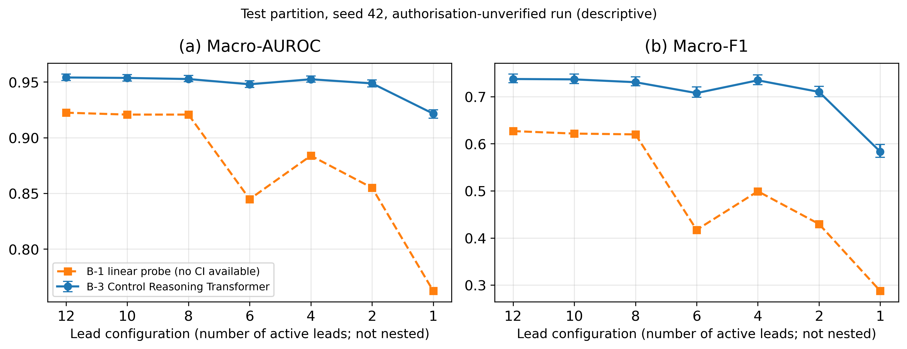
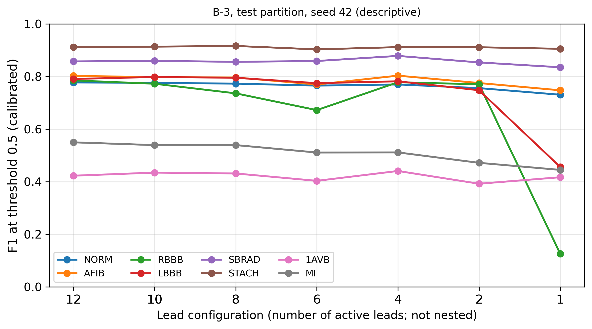

# CHAPTER 4

# EXPERIMENTAL RESULTS AND PERFORMANCE ANALYSIS

This chapter reports the experiments completed in the first half of the project and analyses their results. All numbers are taken from saved run artefacts in the repository, and the artefact behind each table is named with it. The chapter covers the classification part of the research question: how well the frozen foundation model and the Control Reasoning Transformer of Chapter 3 recognise the eight benchmark conditions as leads are removed. The grounding part, which needs the grounding gate of Section 3.3.9, has not yet been implemented, so no grounding quality, Reasoning Failure Boundary or related result is reported here.

One caveat applies to every test result in this chapter. The test evaluation is classified by the project's own provenance statement as authorisation-unverified (Section 3.3.12). Test results are therefore presented as descriptive measurements from the recorded run, not as a confirmatory or independently validated evaluation. The reasons are summarised in Section 4.3.2.

## 4.1 DATASET DESCRIPTION

### 4.1.1 Source Datasets and Versions

The project pools three public 12-lead ECG cohorts, each identified by the exact release obtained (Section 3.3.1). Table 4.1 gives, for each cohort, the release, the source of its diagnostic labels and the number of recordings at each stage of preparation. The counts are those written by the preprocessing stage (`data/processed_100hz/preprocessing_summary.json` and the per-cohort summaries) and confirmed by a recount of the Module 4 split manifest (`runs/module4_v3/split_manifest.csv`).

**Table 4.1 Source Datasets Used in the Project**

| Cohort | Release used | Source of diagnostic labels | Recordings processed | Rejected by quality screening | Eligible recordings |
|---|---|---|---|---|---|
| PTB-XL | PhysioNet release 1.0.3 [22]; dataset described in [18] | SCP-ECG statements assigned by cardiologists [18] | 21,799 | 2 | 21,797 |
| Chapman-Shaoxing | Training set of the PhysioNet/Computing in Cardiology Challenge 2021, release 1.0.3, `chapman_shaoxing` subset [24]; original database [23] | SNOMED CT codes in the record headers | 10,158 | 16 | 10,142 |
| MIMIC-IV-ECG | Release 1.0 [25]; subset of 5,000 recordings, one per patient, sampled with seed 42 | Machine-generated interpretation statements distributed with the dataset | 5,000 | 51 | 4,949 |
| **Total** | | | **36,957** | **69** | **36,888** |

The counts in Table 4.1 describe the project's working subset, which differs from the full releases in two ways. For Chapman-Shaoxing, the records manifest (`data/external_validation/chapman/records_manifest.csv`) lists 10,247 recordings, of which 89 had missing files, leaving the 10,158 processed recordings. For MIMIC-IV-ECG, the project's sampling audit (`reports/dataset_sampling_audit.json`) records a pool of 800,035 recordings from 161,352 patients, from which the 5,000-recording subset was drawn. The subset was sampled to contain roughly equal numbers of recordings for the eight conditions. Because the labels were later re-derived as multi-label, three-state labels, the subset is no longer exactly balanced. PTB-XL release 1.0.3 contains 21,799 recordings, all of which were processed. The PTB-XL publication describes an earlier release with different counts, so the counts here are taken from release 1.0.3 and the repository.

The three cohorts were labelled in different ways, and this affects how their results can be compared. PTB-XL labels come from cardiologists. Chapman-Shaoxing labels are diagnosis codes supplied with the Challenge 2021 distribution. MIMIC-IV-ECG labels are derived from the statements of an automated interpretation program, so they show what that program reported, not a clinician's diagnosis. Differences in labelling practice and population between ECG databases are a known source of difficulty for multi-database classification [8]. The per-cohort results of Section 4.4.5 have to be read with this in mind.

### 4.1.2 Data Partitions

The recordings were divided into training, validation and test partitions by the patient-grouped, label-stratified procedure of Section 3.3.4. Table 4.2 gives the number of recordings and patients in each partition, recounted from the Module 4 split manifest.

**Table 4.2 Recordings and Patients in Each Partition**

| Cohort | Training (folds 1–7) | Validation (fold 8) | Test (folds 9–10) | Total |
|---|---|---|---|---|
| PTB-XL recordings | 15,260 | 2,179 | 4,358 | 21,797 |
| PTB-XL patients | 13,253 | 1,885 | 3,729 | 18,867 |
| Chapman-Shaoxing recordings (each treated as one patient) | 7,100 | 1,014 | 2,028 | 10,142 |
| MIMIC-IV-ECG recordings (one per patient) | 3,465 | 495 | 989 | 4,949 |
| **All recordings** | **25,825** | **3,688** | **7,375** | **36,888** |
| **All patients** | **23,818** | **3,394** | **6,746** | **33,958** |
| Recording–configuration examples (× 7 configurations) | 180,775 per epoch | 25,816 | 51,625 | 258,216 |

Each recording is presented in all seven lead configurations, so the 51,625 test examples are seven views of 7,375 recordings from 6,746 patients. They are not 51,625 independent patients, and all test sample sizes in this chapter should be read in that light.

No patient identifier appears in more than one partition, but this check only has force where identifiers exist. PTB-XL and MIMIC-IV-ECG provide patient identifiers. Chapman-Shaoxing does not, so each of its recordings is treated as a separate patient and patient-level separation cannot be established for this cohort. The Module 1 freeze record lists 13 pairs of identical Chapman-Shaoxing signals stored under different record identifiers. The labels of each pair agree. Nine of the pairs cross partitions: six link the training and test partitions, two the training and validation partitions, and one the validation and test partitions. Seven test recordings therefore have exact copies in data used for training or model selection. This is about 0.1% of the 7,375 test recordings, too few to change the reported metrics in any material way, but it is a genuine leakage and is disclosed as such.

### 4.1.3 Label Distribution

Labels have three states: positive, negative and unknown (Section 3.3.2). Unknown labels are excluded from training and evaluation, so each condition is evaluated on its own subset of recordings. Table 4.3 gives the number of positive labels and the number of known labels for each condition in each partition. The test counts come from the confusion matrices in the saved test summary (`runs/module4_v3/metrics/test_evaluation_summary.json`), because test labels are blanked in the split manifest as a quarantine measure.

**Table 4.3 Positive Labels / Known Labels (Prevalence) in Each Partition**

| Condition | Training | Validation | Test |
|---|---|---|---|
| NORM | 7,889 / 25,730 (30.7%) | 1,128 / 3,675 (30.7%) | 2,225 / 7,347 (30.3%) |
| AFIB | 2,716 / 25,212 (10.8%) | 389 / 3,610 (10.8%) | 788 / 7,188 (11.0%) |
| RBBB | 1,177 / 24,094 (4.9%) | 167 / 3,416 (4.9%) | 336 / 6,870 (4.9%) |
| LBBB | 963 / 24,797 (3.9%) | 135 / 3,536 (3.8%) | 274 / 7,089 (3.9%) |
| SBRAD | 3,701 / 21,982 (16.8%) | 528 / 3,132 (16.9%) | 1,056 / 6,240 (16.9%) |
| STACH | 2,156 / 21,980 (9.8%) | 304 / 3,133 (9.7%) | 622 / 6,237 (10.0%) |
| 1AVB | 995 / 22,414 (4.4%) | 141 / 3,201 (4.4%) | 286 / 6,368 (4.5%) |
| MI | 4,097 / 22,712 (18.0%) | 584 / 3,255 (17.9%) | 1,196 / 6,517 (18.4%) |

The stratified split keeps the prevalence of every condition almost identical across the three partitions. The conditions are strongly imbalanced, from about 4% for left bundle branch block and first-degree atrioventricular block to about 30% for the normal ECG. The test partition still contains at least 274 positive recordings for every condition, so no per-condition test estimate rests on a very small number of positives. The number of known labels differs by condition, from 6,237 to 7,347 test recordings, and per-condition results are therefore computed over different denominators. The project's Stage 7 report gives 754 positive atrial fibrillation recordings in the test partition. The saved test summary, from which that report was written, gives 788, and the project's own post-evaluation audit traced the smaller figure to a transcription error. The value 788 is used here.

## 4.2 ECOSYSTEM (HARDWARE & SOFTWARE SPECIFICATIONS)

The repository has no environment file, package list or saved training log. The specifications in Table 4.4 are therefore limited to what can be established from scripts, run reports and checkpoints. Where a specification is not recorded, the table says so rather than inferring it.

**Table 4.4 Hardware, Software and Training Specifications**

| Item | Specification | Evidence |
|---|---|---|
| Processor and accelerator used for training | Not recorded in the available experiment artefacts. The Stage 6 report states that 16-thread CPU execution was enabled for Module 4; the training script enables this setting only when it runs on the CPU | `runs/module4_v3/reports/stage6_validation_and_audit_report.md`; `scripts/16_train_reasoning_transformer.py` |
| Foundation-model feature extraction | CPU; the extraction script fixes the device to the CPU, and the logs record batch size 32 with 8 threads per worker | `runs/module3_v1/scripts/extract_foundation_representations.py`; `runs/module3_v1/logs/` |
| Inference for validation traces | CPU, 16-thread worker pool | `runs/module4_v3/reports/validation_trace_generation_report.md` |
| Memory (RAM, accelerator memory) | Not recorded in the available experiment artefacts | — |
| Operating system | Windows (test session platform `win32`) | Stage 6 report, test-suite output |
| Python | 3.11.4; pytest 9.1.1 | Stage 6 report, test-suite output |
| Library versions used for the runs | Not recorded in the available experiment artefacts. The Python 3.11.4 installation on the project machine had PyTorch 2.14.0 (CPU build) when this report was written, but this is not evidence of the version used for the runs | Checked on 19 October 2026 |
| Foundation model | ECG-FM [7], `wav2vec2_cmsc`, 12 encoder layers, width 768; 90,883,072 parameters, all frozen; checkpoint `checkpoints/ecg_fm/mimic_iv_ecg_physionet_pretrained.pt` (SHA-256 beginning `4d0142bc`) | `configs/control_path_training_config.json`; Module 4 freeze record |
| Control Reasoning Transformer | 1,830,657 trainable parameters | `configs/control_path_training_config.json`; checkpoints |
| Loss | Binary cross-entropy over known labels (Section 3.3.8) | `scripts/16_train_reasoning_transformer.py` |
| Optimiser | AdamW; learning rate $10^{-4}$; weight decay $10^{-4}$; betas (0.9, 0.999) | Checkpoint optimiser state |
| Batch size | 64 | Checkpoint step count; script default; Stage 6 report |
| Learning-rate schedule | Cosine annealing over 15 epochs to $10^{-6}$, no warm-up | Learning-rate history in `control_training_history_seed*.json` |
| Maximum epochs | 15 | Script default; schedule length |
| Early stopping | Validation loss; patience 5 epochs; minimum improvement $5 \times 10^{-4}$ | Training configuration; script |
| Examples per epoch | 180,775 (25,825 recordings × 7 configurations) | Stage 6 report; step count |
| Seeds | 42 (primary), 1337, 2024 | Training histories |
| Best epoch / last epoch | 3 / 8 for every seed | Training histories |
| Training time | 5,799 s (seed 42), 5,763 s (seed 1337), 5,973 s (seed 2024) | Training histories |
| Calibration | Per-condition temperature fitted on the validation partition [26] | Training histories; checkpoints |

The training settings in Table 4.4 are those that the training run actually used, established from the saved checkpoints and training histories. They differ in three respects from the training configuration file, which specifies a batch size of 32, at most 20 epochs and two warm-up epochs. The training script does not read these three values from the configuration file. It uses its own command-line defaults: a batch size of 64, at most 15 epochs and a cosine schedule without warm-up. The saved run confirms these defaults. The optimiser state stored in the seed-42 checkpoint after epoch 3 has taken 8,475 steps, or 2,825 steps per epoch, which equals 180,775 training examples divided into batches of 64 and rounded up. The learning rate recorded after each epoch follows a cosine curve over 15 epochs from $10^{-4}$ to $10^{-6}$ with no warm-up phase; the recorded value after epoch 8, $4.53 \times 10^{-5}$, matches that curve. The Stage 6 report also states a batch size of 64.

## 4.3 EXPERIMENTS CONDUCTED

### 4.3.1 Overview of the Experiments

Table 4.5 lists the experiments that were carried out, with the artefact that holds each result, its completion status and its main caveat. An experiment is listed as completed only when its saved output was inspected; the existence of a script was not taken as evidence that it ran.

**Table 4.5 Experiments Conducted**

| No. | Experiment | Purpose | Evidence artefact | Status | Key caveat |
|---|---|---|---|---|---|
| E1 | Dataset preparation and quality screening | Standardise the three cohorts and remove unusable recordings | `data/processed_100hz/*/preprocessing_summary.json`; split manifest | Completed: 36,888 of 36,957 recordings retained | Chapman-Shaoxing has no patient identifiers; 13 duplicate pairs |
| E2 | Progressive lead masking and representation extraction | Produce frozen ECG-FM representations for every recording in all seven configurations | `runs/module3_v1/` (freeze record, logs, drift reports) | Completed: 258,216 representations, no failures recorded | Input conditions differ from ECG-FM pretraining (Section 3.3.6) |
| E3 | Clinical observation extraction | Measure rate, rhythm, intervals and ST/T findings on the available leads | `runs/module4_v3/observations/` | Completed for all partitions and configurations | QRS measurement ceiling; rhythm-label mismatch (Section 4.4.8) |
| E4 | Observation-extractor validation study | Compare extracted measurements with reference measurements | `reports/clinical_observation_validation.json` | Completed: 250 MIMIC-IV-ECG recordings | Reference values are machine measurements, not clinician readings |
| E5 | Control Reasoning Transformer training | Train one model over all seven configurations with three seeds | `runs/module4_v3/metrics/control_training_history_seed*.json`; checkpoints | Completed for seeds 42, 1337 and 2024 | Settings differ from the configuration file (Section 4.2) |
| E6 | Calibration | Fit per-condition temperatures and measure calibration | Training histories | Completed on the validation partition | Fitted and measured on the same validation data |
| E7 | Validation evaluation by configuration | Measure validation performance for each configuration and seed | Training histories | Completed for all three seeds | Uncalibrated probabilities |
| E8 | Test evaluation of the Control Reasoning Transformer (B-3) | Measure test performance for each configuration | `runs/module4_v3/metrics/test_evaluation_summary.json`; `test_predictions_seed42.csv` | Completed for seed 42 only | Authorisation-unverified (Section 4.3.2) |
| E9 | Comparison models on the test partition | Class-prevalence model (B-0), linear probe (B-1) and rule engine (B-2) | `runs/module4_v3/metrics/comprehensive_baseline_comparison.json` | Completed after E8 | Script outside the repository; no per-recording predictions; B-2 defective |
| E10 | Representation drift | Cosine similarity of each configuration's representation to the 12-lead representation | `runs/module3_v1/reports/module3_cosine_similarity_summary.csv` | Completed for all partitions | Measures geometry, not diagnostic accuracy |

The following parts of the research programme were not carried out in the first half and have no results in this chapter:

- **Grounding gate and evidence states (Module 5).** Specified in the internal protocol and evidence schema, not implemented. Section 3.3.9 lists the schema revisions required before implementation.
- **Grounding metrics (EO, GQ, TGR, UR, GSR) and the Reasoning Failure Boundary (Module 6).** Not computed, because they need the gate's evidence states.
- **Diagnostic Failure Boundary and AURDC.** Not implemented in the evaluation scripts. Section 4.4.3 explains why no DFB is read off the classification results.
- **Clinical Knowledge Prior and the knowledge-augmented comparison (B-4).** Planned future work.
- **Test evaluation of seeds 1337 and 2024, patient-clustered and paired confidence intervals, and ablations of the observation and lead-availability tokens.** Not run.

### 4.3.2 Evaluation Provenance

The protocol requires the test partition to be evaluated once, after an explicit authorisation by the investigator. The project's provenance statement (`runs/module4_v3/reports/evaluation_provenance_statement.md`) records that this condition was not met: the evaluation was started by an automated hook of the development environment, the first run stopped because of a software error, and the run was repeated after the error had been fixed. Two further facts bear on the run. The data loader (`src/reasoning/multi_cohort_loader.py`) was last modified at 16:08 UTC on 15 October 2026, after the freeze record was written at 06:54 UTC and before the test summary was written at 16:29 UTC, so the evaluation did not use the frozen version of the loader. The test-trace script (`scripts/17_generate_reasoning_traces.py`), which also computes the test metrics, is not listed in the freeze record.

The comparison-model results of experiment E9 were produced after the test evaluation. According to its file timestamp, the comparison file was written at 16:52 UTC on 15 October 2026, 23 minutes after the test summary. The script that produced it (`evaluate_baselines.py`) is stored in the development environment's scratch directory, outside the repository.

For these reasons, every test result in this chapter is a descriptive result from the recorded run. It is not a confirmatory, pre-specified or independently validated evaluation, and the evidence does not establish that the test partition was untouched before the run. The saved test outputs were not re-run, repaired or replaced for this report. The project's post-evaluation audit (`runs/module4_v3/reports/post_evaluation_baseline_reconciliation_audit.md`) recomputed the test metrics from the saved predictions and found that they agree with the saved summary to within rounding. Its Stage 7 Markdown report does not fully agree with the summary: besides the atrial fibrillation count noted in Section 4.1.3, it lists the wrong leads for the 10-lead configuration, and some of its single-lead per-cohort values differ from the summary. Where the two disagree, this chapter uses the saved summary.

### 4.3.3 Evaluation Measures

The measures follow Section 3.3.11. For each condition, the area under the receiver operating characteristic curve (AUROC) and the F1 score are computed over recordings with a known label. The F1 score uses a fixed threshold of 0.5 on the calibrated probabilities. Macro-averages are unweighted means over the eight conditions. Calibration is measured by the Brier score, the negative log-likelihood (NLL) and the expected calibration error (ECE) with 10 equal-width bins [26], each computed per condition and averaged over the eight conditions. The 95% confidence intervals of the test results come from 200 bootstrap resamples of test recordings. These resamples are not grouped by patient, and they are fewer than the 1,000 patient-clustered resamples that the protocol specifies for grounding metrics. Because some PTB-XL patients contribute several recordings, the intervals may be somewhat narrower than patient-level intervals would be.

Two distinctions are necessary when results from different partitions are compared. The test metrics are computed from calibrated probabilities. The per-configuration validation metrics saved during training are computed from uncalibrated probabilities, because the training script evaluates each configuration with the model's raw probabilities, without applying the fitted temperatures. And test results exist for seed 42 only, while validation results exist for all three seeds. The pooled three-seed summary saved by the project (`runs/module4_v3/metrics/multi_seed_variance_summary.json`) gives a macro-AUROC of 0.9449 ± 0.0006 and a macro-F1 of 0.6982 ± 0.0026. These are validation values pooled over all seven configurations, not test values, and they are not set beside the test results as three-seed test performance.

## 4.4 PERFORMANCE ANALYSIS

### 4.4.1 Validation Performance and Seed Variability

Table 4.6 gives the validation macro-AUROC and macro-F1 of each seed in each configuration, from uncalibrated probabilities. The spread is the difference between the highest and lowest of the three seeds.

**Table 4.6 Validation Performance by Seed (Fold 8, 3,688 Recordings per Configuration, Uncalibrated)**

| Configuration | Macro-AUROC: 42 / 1337 / 2024 | Spread | Macro-F1: 42 / 1337 / 2024 | Spread |
|---|---|---|---|---|
| 12-lead | 0.9521 / 0.9521 / 0.9499 | 0.0022 | 0.7241 / 0.7272 / 0.7310 | 0.0069 |
| 10-lead | 0.9513 / 0.9513 / 0.9490 | 0.0023 | 0.7191 / 0.7294 / 0.7286 | 0.0103 |
| 8-lead | 0.9500 / 0.9513 / 0.9481 | 0.0032 | 0.7105 / 0.7240 / 0.7218 | 0.0135 |
| 6-lead | 0.9453 / 0.9452 / 0.9447 | 0.0006 | 0.6950 / 0.7022 / 0.6953 | 0.0072 |
| 4-lead | 0.9493 / 0.9492 / 0.9496 | 0.0004 | 0.7158 / 0.7207 / 0.7311 | 0.0153 |
| 2-lead | 0.9451 / 0.9454 / 0.9442 | 0.0012 | 0.6994 / 0.6936 / 0.7043 | 0.0107 |
| 1-lead | 0.9120 / 0.9122 / 0.9111 | 0.0011 | 0.5713 / 0.5498 / 0.5592 | 0.0215 |

Source: `runs/module4_v3/metrics/control_training_history_seed{42,1337,2024}.json`.

The three seeds produce very similar models. All three reached their lowest validation loss at epoch 3 and stopped at epoch 8, and their best validation losses were 0.15925, 0.15669 and 0.15950. The macro-AUROC of the three seeds differs by at most 0.0032 in any configuration. The macro-F1 varies more, by up to 0.0215 in the single-lead configuration, because a fixed threshold turns small shifts in probability into changes in the number of predicted positives. The ordering of the configurations is the same for every seed: the 12-, 10-, 8- and 4-lead configurations form a group with macro-AUROC between 0.948 and 0.953, the 6- and 2-lead configurations are slightly lower, and the single-lead configuration is clearly lowest. Because only the seed-42 model was evaluated on the test partition, this seed variability is known for validation only. It suggests that differences between configurations much smaller than about 0.003 in macro-AUROC or 0.02 in macro-F1 should not be interpreted, even before sampling uncertainty is considered.

### 4.4.2 Calibration

The temperatures were fitted per condition on the pooled validation partition (25,816 recording–configuration examples). The fitted temperatures lie between 0.93 and 1.26, with a mean of 1.15 for seed 42, 1.13 for seed 1337 and 1.10 for seed 2024. Most are slightly above 1, which means that the model was slightly overconfident and that calibration softened its probabilities. On the pooled validation partition, temperature scaling reduced the mean ECE from 0.01498 to 0.01043 for seed 42, from 0.01193 to 0.00764 for seed 1337 and from 0.01373 to 0.01180 for seed 2024, a reduction of between 14% and 36%. The NLL and Brier score changed only slightly; for seed 42 they fell from 0.15769 to 0.15586 and from 0.04741 to 0.04713 (source: `calibration` field of the training histories). These validation figures are optimistic, because the temperatures were fitted on the same data on which they are measured. The test partition gives an out-of-sample check: with the seed-42 temperatures, the test ECE ranges from 0.0105 in the 12-lead configuration to 0.0132 in the single-lead configuration (Table 4.7). This shows that one set of temperatures, fitted on all configurations together, remains usable when leads are removed, with a small rise in calibration error. The test values before calibration were not saved, so the effect of calibration on the test partition cannot be shown.

### 4.4.3 Test Performance Across Lead Configurations

Table 4.7 and Figure 4.1 give the test results of the seed-42 Control Reasoning Transformer in each configuration.

**Table 4.7 Test Performance of the Control Reasoning Transformer by Configuration (Seed 42, Calibrated, Descriptive)**

| Configuration | Active leads | Macro-AUROC [95% CI] | Macro-F1 [95% CI] | Brier | NLL | ECE |
|---|---|---|---|---|---|---|
| 12-lead | I, II, III, aVR, aVL, aVF, V1–V6 | 0.9540 [0.9514, 0.9572] | 0.7375 [0.7295, 0.7478] | 0.04309 | 0.14367 | 0.01047 |
| 10-lead | I, II, aVR, aVL, V1–V6 | 0.9536 [0.9509, 0.9566] | 0.7367 [0.7278, 0.7483] | 0.04330 | 0.14418 | 0.01071 |
| 8-lead | I, II, V1–V6 | 0.9526 [0.9502, 0.9558] | 0.7307 [0.7228, 0.7421] | 0.04381 | 0.14591 | 0.01100 |
| 6-lead | I, II, III, aVR, aVL, aVF | 0.9479 [0.9450, 0.9510] | 0.7076 [0.6987, 0.7209] | 0.04612 | 0.15259 | 0.01219 |
| 4-lead | I, II, III, V1 | 0.9524 [0.9499, 0.9553] | 0.7347 [0.7253, 0.7461] | 0.04408 | 0.14637 | 0.01247 |
| 2-lead | II, V1 | 0.9487 [0.9455, 0.9519] | 0.7101 [0.7000, 0.7218] | 0.04666 | 0.15322 | 0.01247 |
| 1-lead | II | 0.9215 [0.9175, 0.9251] | 0.5832 [0.5710, 0.5983] | 0.05397 | 0.17846 | 0.01319 |

Source: `runs/module4_v3/metrics/test_evaluation_summary.json`; 7,375 test recordings per configuration; intervals from 200 record-level bootstrap resamples.

**Figure 4.1 Test Macro-AUROC and Macro-F1 by Lead Configuration** (B-3 with 95% bootstrap intervals; B-1 point estimates only, since no intervals can be computed for it; drawn directly from the saved result files)

Three features of the results stand out. First, removing the four derived limb leads changes almost nothing: from 12 to 10 to 8 leads, the macro-AUROC moves from 0.9540 to 0.9536 to 0.9526 and the macro-F1 from 0.7375 to 0.7367 to 0.7307, and the confidence intervals overlap. This is expected, because leads III, aVR, aVL and aVF are linear combinations of leads I and II (Section 3.3.5). The 10- and 8-lead configurations hide these leads from the model but remove no electrical information.

Second, performance does not fall steadily with the number of leads. The 4-lead configuration (macro-AUROC 0.9524, macro-F1 0.7347) is better than the 6-lead configuration (0.9479, 0.7076), and the 2-lead configuration (0.9487, 0.7101) is about as good as the 6-lead one. The configurations are not nested. The 6-lead configuration keeps all six limb leads but no chest lead, whereas the 4-lead and 2-lead configurations keep chest lead V1. The results therefore suggest that, for these eight conditions, V1 carries information that the full set of limb leads does not provide. This agrees with the observation that a well-chosen small lead subset can classify ECG abnormalities as well as larger sets [10]. The lead-count ordering of the configurations is therefore not an ordering of information content. The difference between the 4- and 6-lead configurations (0.0045 in macro-AUROC and 0.0271 in macro-F1) is larger than the variation between seeds in either configuration on the validation partition (Table 4.6), and the macro-F1 intervals do not overlap, but no paired test of the difference is available.

Third, the single-lead configuration is clearly the weakest: its macro-AUROC is 0.9215 and its macro-F1 is 0.5832, against 0.9487 and 0.7101 for the 2-lead configuration. Section 4.4.4 shows that this drop is concentrated in a few conditions.

The Diagnostic Failure Boundary of the protocol is defined from the ratio of each configuration's macro-F1 to the 12-lead macro-F1, with bootstrap intervals for that ratio. Those intervals are not implemented, so no Diagnostic Failure Boundary is reported, although the point estimates above show where macro-F1 falls most.

### 4.4.4 Per-Condition Performance

Table 4.8 gives the per-condition F1 of the Control Reasoning Transformer on the test partition, and Figure 4.2 shows the same values. The number of known labels and positives behind each condition is given in Table 4.3; these denominators are the same in every configuration.

**Table 4.8 Test F1 per Condition at Threshold 0.5 (Seed 42, Calibrated, Descriptive)**

| Condition | 12 | 10 | 8 | 6 | 4 | 2 | 1 |
|---|---|---|---|---|---|---|---|
| NORM | 0.7778 | 0.7761 | 0.7732 | 0.7657 | 0.7701 | 0.7562 | 0.7310 |
| AFIB | 0.8028 | 0.7979 | 0.7966 | 0.7700 | 0.8036 | 0.7755 | 0.7479 |
| RBBB | 0.7855 | 0.7728 | 0.7363 | 0.6725 | 0.7785 | 0.7707 | 0.1266 |
| LBBB | 0.7910 | 0.7985 | 0.7955 | 0.7750 | 0.7821 | 0.7481 | 0.4565 |
| SBRAD | 0.8577 | 0.8599 | 0.8561 | 0.8593 | 0.8787 | 0.8539 | 0.8355 |
| STACH | 0.9121 | 0.9139 | 0.9165 | 0.9035 | 0.9121 | 0.9116 | 0.9058 |
| 1AVB | 0.4230 | 0.4348 | 0.4315 | 0.4035 | 0.4410 | 0.3925 | 0.4172 |
| MI | 0.5500 | 0.5394 | 0.5395 | 0.5112 | 0.5116 | 0.4720 | 0.4451 |

Source: `runs/module4_v3/metrics/test_evaluation_summary.json`.

**Figure 4.2 Test F1 per Condition by Lead Configuration** (B-3, seed 42; drawn directly from the saved test summary)

The per-condition AUROC, from the same file, shows the same picture. Except for myocardial infarction, every condition kept an AUROC of at least 0.917 down to two leads; with lead II alone, the AUROC ranged from 0.8011 for myocardial infarction to 0.9940 for sinus tachycardia. The conditions fall into three groups.

**Rate-based conditions.** Sinus bradycardia and sinus tachycardia keep an AUROC of at least 0.982 and an F1 of at least 0.835 in every configuration, including the single-lead one. Both are defined mainly by heart rate, which can be measured from any lead that shows the QRS complexes. Lead II is retained in every configuration, so the heart rate measured from it, which reaches the model through the interval token, is the same in all seven (Section 3.3.7).

**Conduction blocks.** Right bundle branch block depends on chest lead V1 in a clear way. Its F1 is 0.7855 with all leads, falls to 0.6725 in the 6-lead configuration, which has no chest leads, recovers to 0.7785 and 0.7707 in the 4- and 2-lead configurations, which keep V1, and collapses to 0.1266 with lead II alone, where its recall is 0.074 and its AUROC 0.8408, against 0.9642 with all leads. Left bundle branch block degrades less: its F1 is between 0.748 and 0.799 down to two leads and falls to 0.4565 with one lead, where its AUROC is 0.9441. This pattern is consistent with the project schema, which assigns V1 and V6 to right bundle branch block (Table 3.2), but it does not show that the model uses those leads for the right reasons; establishing that is the purpose of the grounding gate.

**Low-F1 conditions.** First-degree atrioventricular block and myocardial infarction have the lowest F1 in every configuration. For first-degree atrioventricular block, the AUROC is high (0.9501 with all leads), but the F1 is only 0.4230, because the recall at threshold 0.5 is 0.32: only 149 test recordings receive a calibrated probability above 0.5 (92 true and 57 false positives), against 286 positive recordings. A threshold chosen on the validation partition might give a higher F1, but no such threshold was pre-specified, and choosing one now from the test results would not be legitimate. Myocardial infarction has the lowest AUROC (0.8475 with all leads, 0.8011 with one lead). Its criteria in the project schema depend on ST elevation or Q waves in contiguous leads of one territory (Table 3.2), Q waves are not among the extracted observations, and its labels come from three different labelling processes (Section 4.1.1).

### 4.4.5 Performance by Cohort

With all leads, the test macro-AUROC was 0.9476 for PTB-XL (4,358 recordings), 0.9509 for Chapman-Shaoxing (2,028) and 0.9379 for MIMIC-IV-ECG (989), and the corresponding macro-F1 values were 0.6767, 0.6775 and 0.7083. With lead II alone, the macro-AUROC was 0.9163, 0.9260 and 0.8981 (source: `dataset_breakdown` field of the test summary).

The model performs at a similar level on all three cohorts, and the configuration pattern of Section 4.4.3, including the advantage of the 4-lead over the 6-lead configuration, appears in each of them (4-lead and 6-lead macro-AUROC: 0.9431 and 0.9406 for PTB-XL, 0.9618 and 0.9488 for Chapman-Shaoxing, 0.9367 and 0.9318 for MIMIC-IV-ECG). The macro-F1 of each cohort is lower than the macro-F1 of the pooled test partition. A likely reason is that some conditions have few positives in a single cohort, which lowers the cohort's per-condition F1; the project's post-evaluation audit records, for example, only 8 positive myocardial infarction recordings among the Chapman-Shaoxing test recordings. The MIMIC-IV-ECG results measure agreement with machine-generated statements rather than with clinicians, so they are not directly comparable with the other two cohorts [8]. Because the three cohorts were pooled and split together, none of these results is an external validation on an unseen cohort. Nor are they comparable with published PTB-XL benchmarks [6], which use PTB-XL's own folds and label sets.

### 4.4.6 Comparison Models

The comparison models were evaluated on the same 7,375 test recordings and configurations (experiment E9). Table 4.9 compares the linear probe (B-1) with the Control Reasoning Transformer (B-3).

**Table 4.9 Test Performance of the Linear Probe (B-1) and the Control Reasoning Transformer (B-3) (Descriptive)**

| Configuration | B-1 macro-AUROC | B-3 macro-AUROC | B-1 macro-F1 | B-3 macro-F1 |
|---|---|---|---|---|
| 12-lead | 0.9224 | 0.9540 | 0.6269 | 0.7375 |
| 10-lead | 0.9207 | 0.9536 | 0.6216 | 0.7367 |
| 8-lead | 0.9207 | 0.9526 | 0.6199 | 0.7307 |
| 6-lead | 0.8448 | 0.9479 | 0.4172 | 0.7076 |
| 4-lead | 0.8838 | 0.9524 | 0.4991 | 0.7347 |
| 2-lead | 0.8550 | 0.9487 | 0.4296 | 0.7101 |
| 1-lead | 0.7624 | 0.9215 | 0.2874 | 0.5832 |

Source: `runs/module4_v3/metrics/comprehensive_baseline_comparison.json`.

The linear probe is a logistic regression for each condition, fitted on the frozen 12-lead representations of the training partition and applied without calibration at a threshold of 0.5. With all leads, it reaches a macro-AUROC of 0.9224, which shows that the frozen foundation-model representation already separates the eight conditions well. The Control Reasoning Transformer is higher in every configuration, by 0.03 in macro-AUROC and 0.11 in macro-F1 with 12, 10 or 8 leads, and by 0.24 to 0.30 in macro-F1 in the 6-, 4-, 2- and 1-lead configurations. The linear probe follows broadly the same pattern across configurations as the representation drift of Section 4.4.7: it is almost unchanged at 10 and 8 leads, falls most at 6 and 1 leads, and is better at 4 leads than at 6.

This comparison is descriptive and must not be read as evidence that the observation tokens or the lead-availability tokens cause the improvement. The two models differ in several ways at once: the transformer has more capacity, it was trained on all seven configurations whereas the probe saw only 12-lead representations, it receives observation and lead-availability tokens, and its probabilities are calibrated. Under lead removal, the probe is applied to representations unlike any it was fitted on, so part of its decline reflects that mismatch. Separating these factors would need ablation experiments, which have not been run. In addition, the probe's per-recording predictions were not saved, so paired confidence intervals for the differences cannot be computed, and the script that produced these results is outside the repository and was run after the test evaluation (Section 4.3.2).

The other two comparison models are reported only for completeness. The class-prevalence model (B-0) has a macro-AUROC of 0.5 and a macro-F1 of 0 by construction. The rule-engine model (B-2), which applies threshold rules to the extracted observations, has a macro-F1 between 0.2995 and 0.3507 across configurations, but its result has been withdrawn as a comparison because two defects make it uninformative. It never predicts either bundle branch block, so its F1 for both is 0, because the extracted QRS duration never reaches the 120 ms that its rules require (Section 4.4.8). Its atrial fibrillation rule looks for the text "Atrial fibrillation", whereas the extractor writes "Atrial Fibrillation / Irregular rhythm", so the main branch of that rule never matches; its 168 true and 203 false atrial fibrillation detections come only from a secondary rule for irregular rhythms above 100 beats per minute.

### 4.4.7 Representation Stability

Table 4.10 gives the mean cosine similarity between the representation of each recording in a reduced configuration and its 12-lead representation, produced by the frozen foundation model (experiment E10).

**Table 4.10 Mean Cosine Similarity to the 12-Lead Representation**

| Configuration | All partitions (36,888 recordings) | Test partition (7,375 recordings) | Standard deviation (all partitions) |
|---|---|---|---|
| 10-lead | 0.9981 | 0.9980 | 0.0021 |
| 8-lead | 0.9971 | 0.9971 | 0.0027 |
| 6-lead | 0.8775 | 0.8780 | 0.0621 |
| 4-lead | 0.9041 | 0.9041 | 0.0520 |
| 2-lead | 0.8762 | 0.8752 | 0.0621 |
| 1-lead | 0.8144 | 0.8130 | 0.0849 |

Source: `runs/module3_v1/reports/module3_cosine_similarity_summary.csv`.

The representation changes very little when only derived leads are removed (similarity above 0.997) and changes most with a single lead (0.8144). Its ordering follows the classification results closely: the 4-lead representation stays closer to the 12-lead one than the 6-lead or 2-lead representations do, as the 4-lead classification results are better. The values measure the geometry of the representation, not diagnostic accuracy, and a lower similarity does not by itself mean lower accuracy, since the Control Reasoning Transformer was trained on the reduced representations as well.

Two cautions affect the interpretation of these results. First, removed leads are set to zero, so a reduced recording is both missing information and unlike the complete recordings the foundation model was pretrained on. Removing input features changes the input distribution as well as the information available, and the two effects are hard to separate [20]. Second, the foundation model is used outside its pretraining conditions. ECG-FM was pretrained on 5-second segments at 500 Hz with each lead z-score normalised, while this project supplies 10-second segments at 100 Hz in millivolts without normalisation (Table 3.5) [7]. The effect of this mismatch on the representations has not been measured. ECG-FM's pretraining data include the PhysioNet 2021 data, which contain PTB-XL and Chapman-Shaoxing, and MIMIC-IV-ECG [7]. Pretraining did not use diagnostic labels, but record-level overlap between the pretraining recordings and the project's test recordings has not been checked, so the representation may have seen some test recordings during pretraining.

### 4.4.8 Clinical Observation Extractor

The observation extractor was validated in a study of 250 MIMIC-IV-ECG recordings, sampled with seed 42 and compared with the measurements and statements produced by the dataset's automated interpretation program (`scripts/audit_clinical_observations.py`). The study was run on 6 October 2026, before the Module 4 freeze record was written on 15 October. The extractor source file was last modified on 23 September 2026, before the study, and its current SHA-256 hash matches the hash in the freeze record. The study therefore used the extractor code that was later frozen. The study did not record a code hash of its own.

Against the reference values, heart rate had a mean absolute error of 3.70 bpm (median 0.96 bpm; Pearson r = 0.866), the PR interval 21.57 ms (median 14.0 ms; r = 0.581) and the QRS duration 28.92 ms (median 26.0 ms; r = 0.255). Rhythm detection reached an F1 of 0.917 for sinus bradycardia, 0.681 for sinus tachycardia (sensitivity 0.517) and 0.475 for atrial fibrillation (sensitivity 0.633, precision 0.380, from 19 true and 31 false positives). The ST-segment and T-wave rules were not validated. The study labels the heart-rate measurement "clinically validated", although it compared it only with machine measurements (source: `reports/clinical_observation_validation.json`).

Heart rate, measured with the Pan–Tompkins-style detector of Section 3.3.7 [14], agrees well with the machine measurements. The PR interval agrees only moderately, and the QRS duration agrees poorly. The reference values are themselves produced by an automated program, so the study measures agreement between two algorithms, not accuracy against a clinician; it is evidence of reasonableness rather than clinical validation.

The extracted observations of the training partition show two limitations directly. The extracted QRS duration of the 25,715 training recordings with a measurement lies between 50 and 110 ms, and none reaches 120 ms, because the QRS search window of ±60 ms at 100 Hz cannot measure a wider complex (Section 3.3.7). The PR interval lies between 100 and 250 ms, and 2,460 recordings exceed 200 ms. The rhythm labels written by the extractor are "Sinus rhythm" (13,673 recordings), "Sinus Bradycardia" (5,875), "Atrial Fibrillation / Irregular rhythm" (3,828), "Sinus Tachycardia" (2,239) and "Indeterminate rhythm" (210). Only "Sinus rhythm" matches the rhythm vocabulary of the context builder, so the other 12,152 training recordings (47.1%) receive the same out-of-vocabulary rhythm token (Section 3.2).

These limitations matter for interpreting the classification results. The Control Reasoning Transformer receives the capped QRS values and the merged rhythm token as inputs, so for bundle branch block and atrial fibrillation it must rely on the foundation-model representation and the other tokens. Its good results for those conditions (AUROC 0.9642 to 0.9804 with all leads) show that it can do so, but the observation tokens cannot be assumed to contribute the information they were designed to provide. The same limitations will matter even more for the grounding gate, which will judge each claim against these measurements: with the current extractor, a bundle branch block claim could never be supported by a measured QRS duration (Section 3.3.9).

### 4.4.9 Discussion

The first-half experiments establish a complete, reproducible classification pipeline across seven lead configurations and three cohorts. The frozen foundation model gives a representation that separates the eight conditions well (linear-probe macro-AUROC 0.9224 with all leads), and the Control Reasoning Transformer, trained once over all configurations, reaches a test macro-AUROC of 0.9540 with all leads and keeps it above 0.947 down to two leads. Diagnostic performance falls clearly only with a single lead, and it falls unevenly across conditions: rate-based conditions are unaffected, while right bundle branch block depends visibly on the presence of V1.

These findings answer only the diagnostic half of the research question. The project's central question is whether the evidence for a prediction remains observable and consistent with the measurements as leads are removed, and the classification results alone cannot answer it. A model can keep a high AUROC on a single lead by relying on features that a cardiologist would not accept as evidence for the condition. The attention-based traces produced alongside the predictions do not settle the question either, because attention weights are not a reliable account of which inputs drove a prediction [13], and the traces do not yet contain verifiable clinical claims (Section 3.3.8). Measuring that requires the grounding gate.

Several factors other than the reasoning model could explain parts of the results, and they should be considered before attributing any behaviour to the model itself: the different labelling processes of the three cohorts, the foundation model's non-native input conditions and possible pretraining overlap, the zero-masking of removed leads, the observation extractor's QRS ceiling, heuristic PR measurement, missing morphology measures and rhythm-label mismatch, and the small number of duplicated recordings. None of these is large enough to invalidate the classification results as descriptive measurements, but together they limit how far the results can be generalised.

The test results are a single seed of a single authorisation-unverified run, and they should be confirmed by an authorised, separately versioned evaluation before any confirmatory claim is made. Section 4.3.1 lists the parts of the research programme for which no results exist yet.

<!-- CITATION MAP (not rendered). Global numbering continues from earlier chapters; numbers shared with earlier chapters are unchanged. Keys refer to REFERENCES.bib / REFERENCE_LIBRARY.md.
[6] STRODTHOFF2021PTBXL
[7] MCKEEN2025ECGFM
[8] REYNA2022ISSUES
[10] LAI2021LEADSELECTION
[13] JAIN2019ATTENTION
[14] PAN1985QRS
[18] WAGNER2020PTBXL
[20] HOOKER2019ROAR
[22] WAGNER2022PTBXLDATA
[23] ZHENG2020CHAPMAN
[24] CINC2021DATA
[25] GOW2023MIMICIVECG
[26] GUO2017CALIBRATION
-->
